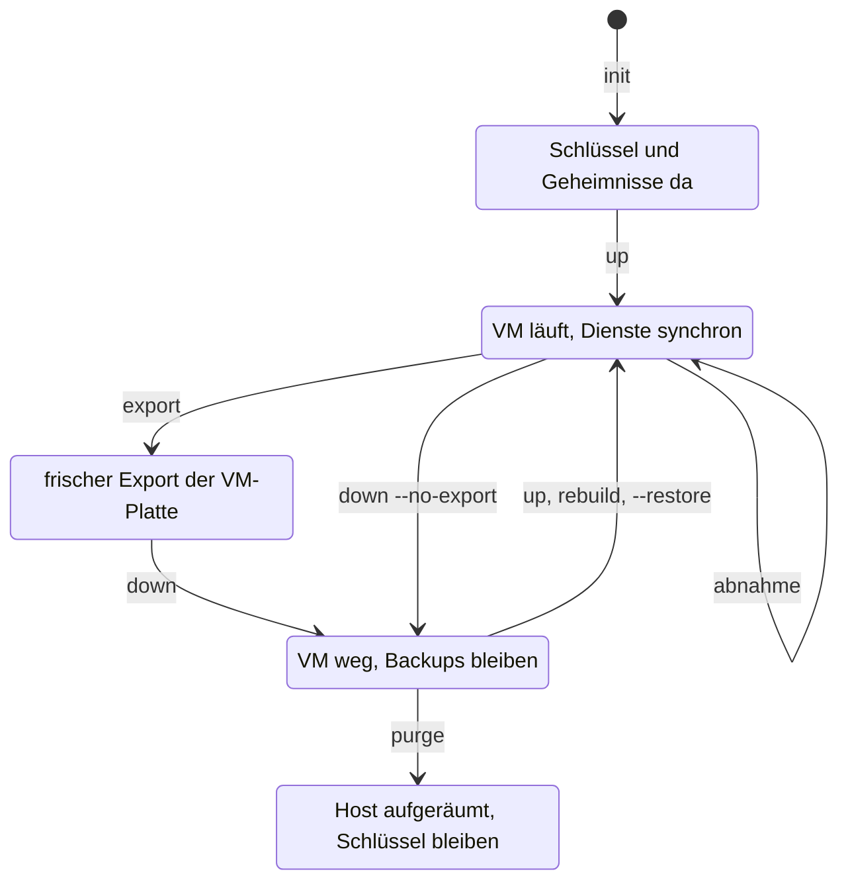

# Referenz: `scripts/lab.sh`

`lab.sh` ist ein dünner Wrapper. OpenTofu baut das Haus (VM), Ansible richtet es
ein, Argo CD bringt die Dienste; das Skript ruft nur der Reihe nach auf, prüft vorher
und misst die Zeit. Es enthält **keine Werte** (alle stehen in
[`lab.yaml`](configuration.md) und `group_vars`) und zeigt nie den Wert eines
Geheimnisses.

```bash
bash scripts/lab.sh <command> [options]
```

!!! note "Namen der Befehle"
    Alle Befehle und Optionen heissen englisch ([Issue 13](https://github.com/tabee/k8s-lab-template/issues/13)). Die alten deutschen
    Namen laufen als Alias weiter und melden auf stderr einen Hinweis; ihre Entfernung steht in [Issue 43](https://github.com/tabee/k8s-lab-template/issues/43).
    Die Tabelle steht unter [Veraltete Namen](#veraltete-namen).

## Werkzeuge vor dem Aufbau

`bash scripts/lab.sh tools install` installiert die Werkzeuge auf Ubuntu 24.04;
`bash scripts/lab.sh tools check` prüft ohne Änderungen, sudo oder Downloads.
**Eselsbrücke:** erst die Werkbank, dann das Haus.
[Umfang, Pins und Optionen](control-tools.md).

## Lebenslauf der VM



## Befehle

| Befehl | Zweck | Ändert etwas? |
|---|---|---|
| `up` | VM bauen und alles einrichten (idempotent) | ja |
| `down` | VM abreissen; Daten im Cluster weg, Backups bleiben | ja, zerstörerisch |
| `rebuild` | `down` und `up`, Stoppuhr je Phase und gesamt | ja, zerstörerisch |
| `purge` | `down` und den Host gründlich aufräumen, doppelte Rückfrage | ja, zerstörerisch |
| `status` | Zustand ansehen | nein |
| `acceptance` | messen und beweisen, mit Dummy-Daten | nur Wegwerf-Objekte |
| `restore-drill` | beweisen, dass Gitea aus den Backups allein zurückkommt (Wegwerf-Namespace), doppelte Rückfrage | nur Wegwerf-Objekte |
| `rebuild --restore` | VM aus den Backups neu bauen, ohne rustfs zu leeren, Git bleibt `initdb`, doppelte Rückfrage | ja, zerstörerisch |
| `gitea-import DUMP` | Dump der Produktions-Forge ins Lab-Gitea einspielen (`recipients`, `accept`, `recover`; eigene Optionen, [Gitea-Import](../how-to/gitea-import.md)) | ja, ersetzt mit `--replace` den Inhalt von Gitea |
| `matrix-import DUMP` | Dump des Produktions-Synapse ins Lab-Matrix einspielen (`recipients`, `prepare`, `accept`, `backup`, `recover`; eigene Optionen, [Matrix-Import](../how-to/matrix-import.md)) | ja, ersetzt mit `--replace` den Inhalt von Matrix; `prepare` schreibt `lab.local.yaml` und die Schlüsseldatei |
| `replica AKTION` | Kopie der Backups auf einem zweiten Rechner (`config`, `hostkey`, `install`, `status`, `verify`, `mirror`, `preflight`, `restore VERZEICHNIS`) | `install` schreibt Konfiguration, Timer und Schlüssel |
| `alert AKTION` | Alarme bei Backup- oder Kantenausfall (`install`, `status`, `run`, `test`, `verify`) | `install` schreibt Konfiguration und Timer |
| `export` | Sicherung der VM-Platte (Fallschirm vor dem Abreissen) | schreibt in `export_dir` |
| `preflight` | nur die Vorprüfungen | nein |
| `init` | Schlüsselbund anlegen und SOPS-Dateien rendern | schreibt Dateien |
| `ca-rotation` | Lab-CA durch eine mit nameConstraints ersetzen | schreibt Dateien |
| `secrets` | Geheimnis-Karte: Pfad, Rechte, Kopierbefehl (nie Werte) | nein |
| `customize` | Werte aus `lab.yaml` in `gitops/` und `zensical.toml` schreiben | schreibt Dateien |
| `trust AKTION` | Quellvertrauen: `status`, `init COMMIT`, `check`, `release` ([Konzept](../concepts/source-trust.md)) | `init` schreibt `~/.config/k8s-lab/trusted-head`, nach getippter Bestätigung; `release` löst den Pin von Argo CD |
| `source AKTION` | Quelle von Argo CD: `status`, `github`, `gitea` ([Anleitung](../how-to/neuaufbau-github.md)) | `github` und `gitea` schreiben `lab.local.yaml` und `gitops/` (wie `customize` und `repo-egress`); danach committieren, signieren und pushen |
| `kit AKTION` | Notfall-Kit: `export DIR`, `verify DIR`, `import DIR` (alle Schlüssel und Passwörter des Steuerrechners in ein verschlüsseltes Archiv auf einem Stick, [Referenz](emergency-kit.md)) | `export` schreibt nur in `DIR`; `import` schreibt Dateien unter `$HOME` und im Klon, nie über abweichende Dateien ohne `--force` |
| `sync-host` | laufende VM: Argo-CD-Projekte (`argocd.yml`) und `/etc/hosts` (`backup-host.yml`) an Git angleichen | ja, aber idempotent; fragt `sudo` |
| `public ZIEL` | öffentliche Fassung erzeugen | schreibt `ZIEL` |
| `guard ORDNER` | Ordner auf Geheimnisse und persönliche Werte prüfen | nein |

`public` und `guard` gibt es nur in der privaten Fassung
([Öffentliche Fassung](../how-to/public-release.md)). `lab.sh help` und `lab.sh`
ohne Argument zeigen die Kurzhilfe (Exit-Code 2).

### `up` {#up}

Zwölf Phasen, jede mit Zeit:

| # | Phase | Inhalt |
|---|---|---|
| 1 | Preflight | Werkzeuge, libvirt, Platz, Schlüssel, Git-Stand, Netzwerte |
| 2 | Basis-Image | gepinntes Ubuntu-Image, SHA-256-geprüft, im Cache |
| 3 | Postgres-Bucket vorab | nur wenn nötig (`BUCKET_MODUS`, siehe unten) |
| 4 | VM bauen | `tofu init`, `plan`, Plan prüfen, `apply` |
| 5 | VM erreichbar | SSH und cloud-init abwarten (`wait_ssh`) |
| 6 | PC einrichten | `backup-host.yml`: rustfs, Buckets, `/etc/hosts` (`sudo`) |
| 7 | Bucket nachprüfen | optional (`bucket_nach`) |
| 8 | `site.yml` | Basis, Firewall, k3s |
| 9 | `argocd.yml` | Argo CD, Lab-CA, Doku-Site, Notiz-Sites |
| 10 | Argo-Sync abwarten | bis alles `Synced` und `Healthy` ist (`wait_argo`) |
| 11 | `public.yml` | nur wenn `acme_*` gesetzt ist, sonst `SKIP` |
| 12 | Datenbanken gesund | `pg-lab` und `gitea-db` bereit |

Am Ende steht, wie viele Änderungen (`changed`) jeder Ansible-Lauf gemacht hat,
und `FERTIG: Lab laeuft. Naechster Schritt: bash scripts/lab.sh acceptance`. Beim
zweiten Aufruf erwartet man `changed=0`.

`BUCKET_MODUS` steuert die Phase 3:

| Wert | Wann | Wirkung |
|---|---|---|
| `nichts` | Standard | Bucket wird nicht angefasst |
| `pruefen` | VM fehlt und `tofu` kennt keine Ressourcen | alter WAL-Inhalt im Bucket: **Abbruch** mit `Expected empty archive` |
| `leeren` | `rebuild` | Postgres-Bucket wird vor dem neuen Cluster geleert |
| `nichts` | `rebuild --restore` | Bucket bleibt. Die Cluster lesen das volle Archiv und schreiben in den nächsten leeren Namen. Git bleibt `initdb` |

!!! warning "Voller Bucket ist `rebuild --restore`, nicht `up`"
    `up` bricht bei altem WAL ab. `rebuild` ohne Schalter leert das Archiv und ist ein sauberer Start, kein
    Restore. Nach einem echten Ausfall (Platte weg, Buckets da) gilt
    [`rebuild --restore`](#restore-befehl). [`restore-drill`](#restore-drill-befehl) beweist denselben Weg
    im Wegwerf-Namespace und löscht nichts Echtes.

### `down`, `rebuild`, `purge` {#down-rebuild-purge}

| Schritt | `down` | `rebuild` | `purge` |
|---|---|---|---|
| frischer Export nötig (Schutz) | ja, sonst `--no-export` | ja | ja |
| Rückfrage | `[j/N]`, `--yes` überspringt | `[j/N]`, `--yes` überspringt | **immer doppelt** |
| VM, Platte, Snapshots entfernen | ja | ja | ja |
| `known_hosts`, Kubeconfig entfernen | ja | ja | ja |
| Postgres-Bucket leeren | nein | ja | ja (und löschen) |
| End-WAL des letzten CNPG-Backups archiviert | ja, sonst Abbruch | ja (über `down`) | nein |
| rustfs-Buckets löschen, `purge-host.yml` | nein | nein | ja |
| Image-Cache, Basisvolume | bleibt | bleibt | nur mit `--include-image` |

`purge` räumt zusätzlich auf: libvirt-Domain und -Volumes, Zustand von OpenTofu
(`tfstate`, `.terraform/`; die Lock-Datei bleibt), alle Exporte ausser den
zwei neuesten, Logs älter als 30 Tage und den Ansible-Cache. Tabelle mit allem,
was bleibt: [Neuaufbau](../how-to/rebuild.md#was-bleibt-was-geht).

### `restore-drill` {#restore-drill-befehl}

Verlangt eine laufende VM, die Kubeconfig und einen **frischen Export**; `--no-export` gilt nicht. Fragt doppelt (das Wort
`restore-drill`, dann den VM-Namen), `--yes` überspringt das nicht. Führt `restore-drill.yml` aus: Gitea
(Datenbank und Dateien) wird in einem Wegwerf-Namespace aus den Backups wiederhergestellt, gemessen und mit dem
Live-Zustand verglichen. Nichts Echtes wird gelöscht. Ablauf und Messwerte: [Restore-Test](../how-to/restore-drill.md).
Den deutschen Namen `wiederherstellen` aus dem Ticket gibt es nicht, auch nicht als Alias.

### `rebuild --restore` {#restore-befehl}

Baut die VM aus den Backups neu, wenn die Platte weg ist und rustfs noch da ist
([ADR-0018](../concepts/decisions/0018-recover-from-backup.md)). Fragt doppelt (das Wort
`restore`, dann den VM-Namen). `--yes` überspringt das nicht. `--no-export` gilt nicht.
Ein frischer Export ist Pflicht. Der Arbeitsbaum muss sauber sein, der Branch `main`.

Der Schalter leert rustfs nicht und ändert kein Git. Die vier Cluster (`pg-lab`,
`gitea-db`, `matrix-db`, `keycloak-db`) bleiben in Git auf `bootstrap.initdb`. Die
Recovery-Spec wird nur im Cluster angelegt. Läuft die VM noch, legt der Befehl vorher
ein neues CNPG-Basis-Backup pro Datenbank (auch `keycloak-db`) und ein neues K8up-Backup
pro Volume an und wartet. Schlägt das fehl, oder hat ein Cluster kein abgeschlossenes
Backup, bleibt die VM stehen. Der Renderer liest nur eine Generation, deren End-WAL
auf der Platte liegt. Danach laufen die Phasen von `up`. Gitea und Matrix bekommen ihre
Dateien aus dem neuesten K8up-Snapshot dieses PVC (volle Snapshot-Id, Pfad `/data/<claim>`).
Fehlt das Snapshot oder kommt das Volume leer zurück, stoppt die Wiederherstellung.
Danach geht der Sync wieder an, die Hooks werden neu geschrieben und `gitea doctor` läuft.
Keycloak hat keine Dateien und deshalb keinen K8up-Teil: seine Datenbank kommt wie die
anderen aus dem Archiv, der Realm-Job läuft danach neu. Voraussetzung ist ein fertiges
Basis-Backup von `keycloak-db` ([ADR-0019](../concepts/decisions/0019-keycloak-sso.md)).
`up` und `rebuild` ohne Schalter ändern ihr Verhalten nicht.

Die Pause hält zuerst die App `root` an (sonst heilt sie `gitea` und `matrix` zurück), dann die beiden Kinder. Sie wartet auf
einen laufenden Sync, startet einmal einen von Hand, falls noch keiner gelungen ist, setzt das Deployment auf 0 und wartet, bis
kein Pod das PVC mehr einhängt. Das Warten auf Argo CD ignoriert `root`, `gitea` und `matrix`, solange die Pause gilt. Bricht der Lauf
ab, nennt die Warnung den genauen Befehl zum Weitermachen (`recover-files.yml --tags ...`, je nach Stand `pause,restore,resume,verify`,
`restore,resume,verify` oder `resume,verify`). `resume` setzt die Kinder und
zuletzt `root` zurück. Vor dem Apply der Recovery-Specs wartet `restore-clusters.yml` auf den Webhook von CNPG.
Beides: [Neuaufbau](../how-to/rebuild.md#restore-stolpersteine). `up`, `rebuild`, `down` und `purge` schreiben
ausserdem den [Wartungsmarker](../how-to/alerts.md#wartungsmarker), damit der Desktop-Alarm schweigt.

**Wächter.** Vor den Rückfragen prüft der Befehl eine laufende VM («Restore guard»): Markierung eines unfertigen Restores, fehlende
Datenbank-Cluster, `root`, `gitea` oder `matrix` ohne `automated`, kein bereiter Pod, leeres Datei-Volume. Bei einem Fund bricht
er mit Exit 1 ab, ohne Backup und ohne etwas zu zerstören, und nennt drei Wege (von Hand fertig machen, neu anfangen, Fehlalarm).
Die Markierung (`restore_state_file`, `group_vars/all/restore.yml`) schreibt `lab.sh` direkt vor dem Abbau, und
`recover-files.yml --tags verify` löscht sie als letzten Schritt. Ein einfaches `rebuild` löscht sie ebenfalls. Warum das so ist
(K8up sichert nachts auch ein leeres Volume): [Neuaufbau](../how-to/rebuild.md#restore-halb).

Anleitung: [Datenbank wiederherstellen](../how-to/restore-database.md).
Gegenüberstellung mit `purge` und anschliessendem `up`:
[Neuaufbau](../how-to/rebuild.md#restore-oder-leer).

### `replica`, `alert` {#replica-alert-befehle}

Dünne Aufrufe der Skripte `lab-replica.py` und `lab-alert.py` (Pfade und Konfiguration kommen aus `group_vars`) und
der Playbooks `backup-replica.yml`, `backup-alert.yml`, `verify-alerts.yml`. Ohne Aktion gilt `status`. Beide
verweigern, wenn `backup_replica_enabled` beziehungsweise `backup_alert_enabled` auf `false` steht.
Anleitungen: [Backup-Replikat](../how-to/backup-replica.md), [Alarm](../how-to/alerts.md).

### `acceptance` {#acceptance-befehl}

Verlangt eine laufende VM und die Kubeconfig, fragt einmal `sudo` und führt neunzehn
Phasen aus (Details und Tags: [Abnahme-Prüfungen](acceptance-checks.md); Phase 18 ist Matrix, Phase 19 Keycloak). Während des Laufs misst ein
Hintergrundprozess die Speicher-Spitzen (`kubectl top`) nach `<log_dir>/memory-peaks.json`; am Ende steht der Vergleich mit
den Limits im Log. Die
Nachweise (`Restore ok: `, `PITR bis `, `Restore-Test`) werden aus dem Log
gesammelt und am Ende gedruckt. Ergebnis: `ACCEPTANCE PASSED: all N checks ok.`
(Exit 0) oder `ACCEPTANCE NOT PASSED: …` (Exit 1).

### `budget` {#budget-befehl}

Vergleicht die Speicher-Spitzen der letzten Abnahme (`<log_dir>/memory-peaks.json`) mit den Limits in Git
(`# lab-limit:`-Markierungen) und druckt einen Vorschlag. Ändert nichts. Mit `--apply` schreibt der Befehl die
vorgeschlagenen, **niedrigeren** Limits in die Dateien (nie ein höheres), hebt bei Bedarf `memory_reserve_mib` an
und aktualisiert die Tabelle in [Memory-Budget](memory-budget.md). Danach: ansehen (`git diff`), committen,
pushen, `cd ansible && ansible-playbook argocd.yml` (Limits von Argo CD) und die Abnahme wiederholen.
Die Regel: `neu = min(aktuell, max(64 MiB, aufgerundet(Spitze × 1,5)))`.

### `export` {#export-befehl}

Schreibt `<VM>-before-drill-<Zeitstempel>.qcow2` mit `.xml` und `.sha256` nach
`export_dir` (Modus 0700/0600). Prüft vorher den freien Platz. Läuft die VM,
wartet der Befehl, bis das End-WAL jedes abgeschlossenen CNPG-Backups
archiviert ist (`scripts/lab-wal-ready.py`), und bricht sonst ab, ohne die
VM zu stoppen. Ein Cluster ohne abgeschlossenes Backup ist derselbe Abbruch. Danach fährt er sie sauber herunter und startet sie wieder;
mit `--live` wird sie im Betrieb gelesen (absturzkonsistent, nicht sauber),
die WAL-Prüfung läuft trotzdem. Danach `qemu-img check`. Ein Export gilt als
frisch, wenn qcow2, `.sha256` und `.xml` da sind und er jünger als
`export_max_age_h` ist. Rückweg: [VM exportieren und zurückholen](../how-to/export-and-restore-vm.md).

### `init`, `secrets`, `ca-rotation` {#init-befehl}

Rufen `scripts/lab-secrets.py` auf (`karte`, `init`, `ca-rotation`). `init` ist
idempotent: vorhandene Dateien bleiben (`SKIP`). Meldungen: `ERZEUGT`,
`WIEDERHERGESTELLT`, `WUERDE ERZEUGEN` (nur mit `--dry-run`), `HINWEIS`, `ABBRUCH`.
Neue Deploy-Keys: der öffentliche Teil wird gedruckt, mit dem Hinweis „NUR LESEND
eintragen“. `sops` ist nötig. Nichts wird committet oder gepusht. Ablauf:
[Geheimnisse anlegen und rotieren](../how-to/secrets.md),
[CA-Rotation](../how-to/ca-rotation.md), [Geheimnis-Karte](secrets-map.md).

### `customize` {#customize-befehl}

Schreibt `domain`, `repo_url`, Gateway sowie VM- und Ingress-Netze aus
`lab.yaml` in `gitops/` und `zensical.toml` (`scripts/lab-customize.py`), damit
Argo CD sie aus Git lesen kann; `gitops/values-state.yaml` merkt den Stand.
Idempotent (`SKIP` beim zweiten Lauf). Danach committen und pushen.
`--fetch-host-keys` liest die Host-Keys des Git-Servers (TOFU), zeigt die
Fingerabdrücke und trägt sie nach Rückfrage als `repo_known_hosts` in
`lab.local.yaml` ein. Vergleiche den Fingerabdruck über einen zweiten Weg.

### `trust` {#trust-befehl}

`status` zeigt den vertrauten Commit. `init COMMIT` legt ihn fest (getippte ersten 7 Zeichen, Terminal nötig).
`check` holt `main` von `repo_url`, prüft es wie der Preflight und rückt den Anker vor. Die Prüfung selbst
(Nachfahre des Ankers, jeder Commit von einem Signer des Eltern-Commits signiert) und die Rückgabewerte
(0 geprüft, 1 nicht geprüft, 2 falsche Anwendung, 3 kein Anker) liegen in `scripts/lab-trust.sh`.
`release` löst den Pin, an den `up` und `rebuild` Argo CD während des Laufs binden
([Pin](../concepts/source-trust.md#pin-waehrend-des-neuaufbaus)). `up` und `rebuild` lösen ihn selbst nach der
bestandenen Zweitprüfung; `trust release` ist für den Fall, dass sie fehlgeschlagen ist. Es prüft `main` zuerst
und bricht ab, wenn die Prüfung nicht besteht (`--trust-override` mit getippter Bestätigung als Ausweg). Anleitung:
[Privater GitHub-Spiegel](../how-to/github-push-mirror.md#vertrauten-commit-festlegen).

### `source` {#source-befehl}

`status` zeigt die Quelle, die Adresse, die Argo CD liest, und ob `gitops/` dazu passt. `github` und `gitea` setzen
`source:` in `lab.local.yaml` (Modus bleibt), rufen `customize` und `repo-egress` auf und nennen die nächsten Schritte.
`github` bricht ab, wenn `<deploy_key>.pub` fehlt (`lab.sh init` legt ihn an). Im Modus `github` prüft der Preflight
zusätzlich, dass der Commit auf GitHub gleich `origin/main` ist, dass `github.com` in `github_egress_cidrs` liegt und
dass das Quellvertrauen besteht. Ist Gitea nicht erreichbar, warnt der Preflight und vergleicht mit dem lokalen `main`
(Anleitung: [Wenn Gitea nicht erreichbar ist](../how-to/neuaufbau-github.md#wenn-gitea-nicht-erreichbar-ist)).
Anleitung: [Neuaufbau aus GitHub](../how-to/neuaufbau-github.md).

### `kit` {#kit-befehl}

`export DIR` schreibt `k8s-lab-kit.tar.age` (age, Passphrase), `k8s-lab-kit.manifest` und `README-NOTFALL.txt` auf den Stick.
`verify DIR` entschlüsselt nur in ein 0700-tmpfs und vergleicht mit dem Manifest. `import DIR` legt die Dateien an ihre
ursprünglichen Pfade zurück und überschreibt nichts Abweichendes ohne `--force`. Optionen, Dateiliste, Rückgabewerte und
das Format des Manifests: [Notfall-Kit](emergency-kit.md). Ablauf im Ernstfall:
[Notfall-Neuaufbau](../how-to/notfall-neuaufbau.md). Die Logik liegt in `scripts/emergency-kit.sh`.

### `sync-host` {#sync-host-befehl}

Für einen **neuen Dienst auf der laufenden VM** (neuer Namespace, neue Notizbuch-Site, neuer Hostname in Git). Verlangt
eine laufende VM und die Kubeconfig, fragt einmal `sudo` und führt der Reihe nach aus: `argocd.yml` (AppProject-Ziele
für neue Namespaces, Bootstrap, SOPS-Schlüssel, Lab-CA, Doku) und `backup-host.yml` (rustfs, Buckets und der verwaltete
Block in `/etc/hosts` über die Rolle `lab_hosts`). Beide sind idempotent: ohne Neues steht am Ende `changed=0`. Die VM
wird nicht angefasst, nichts wird gepusht, und ein Fehler in `argocd.yml` stoppt den Lauf vor `backup-host.yml`.
**Nicht während** eines laufenden `rebuild --restore` ausführen. Ablauf und Hintergrund:
[Neuer Dienst auf der laufenden VM](../how-to/rebuild.md#neuer-dienst-auf-der-laufenden-vm).

## Optionen

| Option | Gilt für | Wirkung |
|---|---|---|
| `--yes` | `down`, `rebuild` | `[j/N]` überspringen (`purge`, `restore-drill` und `rebuild --restore` fragen **immer** doppelt) |
| `--restore` | nur `rebuild` | Postgres-Bucket behalten, Recovery nur im Cluster, Git bleibt `initdb` |
| `--no-export` | `down`, `rebuild`, `purge` | ohne frischen Export (Daten der VM sind danach weg). Gilt nicht für `rebuild --restore` |
| `--live` | `export` | VM nicht herunterfahren |
| `--destroy-ok` | `up` | `up` darf bestehende Teile ersetzen (sonst verweigert es einen Plan mit `replace`/`destroy`) |
| `--include-image` | `purge` | auch Image-Cache und libvirt-Basisvolume löschen |
| `--new-age-key` | nur `init` | eigenen age-Schlüssel in `.sops.yaml` eintragen (bei fremden Empfängern) |
| `--dry-run` | nur `init`, `customize`, `ca-rotation` | anzeigen, nichts schreiben |
| `--fetch-host-keys` | nur `customize` | Host-Keys des Git-Servers holen |
| `--trust-override` | `up`, `rebuild`, `preflight`, `trust release` | einen Commit annehmen, der das Quellvertrauen nicht besteht; verlangt die getippten ersten 7 Zeichen der Commit-ID, `--yes` überspringt das nicht |
| `--git-init` | nur `public` | frisches Git mit einem Commit im Ziel |
| `--replace` | nur `public` | Ziel überschreiben, `.git` bleibt |

Eine Option an einem falschen Befehl bricht ab (`--dry-run gilt nur für …`).
Unbekannte Optionen und überzählige Argumente ebenso.

## Umgebung, Logs, Rückgabewerte

| Was | Wert |
|---|---|
| `LAB_POLL` | Abfrageintervall der Wartephasen in Sekunden, Standard 10 |
| `LAB_KVM` | Pfad der KVM-Gerätedatei, die der Preflight auf Lese- und Schreibrecht prüft; Standard `/dev/kvm`. Gedacht für die Tests (`tests/lab-sh-tests.sh` zeigt auf eine Attrappe); auf einem echten Rechner nicht ändern |
| `LAB_INVENTORY_HOST` | Name des Inventory-Hosts, auf dem `lab.sh` Werte und Geheimnisse mit `ansible <host> -m …` liest; Standard `backup_host`. Die **eine** Stelle im Skript ist die Variable `INVENTORY_HOST`; Playbooks und Inventory führen den Host unter demselben Namen |
| `LAB_TOOLS_EXTRA` | Zusätzliche Werkzeuge (durch Leerzeichen getrennt), die der Preflight neben der festen Liste verlangt, zum Beispiel `tmux jq` |
| `LAB_REQUIRE_TTY` | Standard `1`: Rückfragen (`[j/N]`, ohne `--yes`), die doppelte Rückfrage von `purge`, `restore-drill` und `rebuild --restore` und die einmalige Abfrage des sudo-Passworts verlangen ein Terminal, sonst bricht `lab.sh` ab; der Preflight warnt dann. Mit `0` entfällt nur die Terminal-Prüfung, die Antworten kommen von der Standardeingabe. Die Rückfragen selbst bleiben bestehen. Gedacht für Tests, nicht für den Betrieb |
| `LAB_RESTORE_START_OVER` | `1`: `rebuild --restore` zerstört eine laufende, womöglich halb wiederhergestellte VM **ohne** frisches Backup und ohne Wächter und spielt die vorhandenen Backups ein. Nur wirksam für `rebuild --restore` |
| `LAB_RESTORE_GUARD_FORCE` | `1`: `rebuild --restore` überspringt die Live-Prüfungen des Wächters (Cluster, Argo CD, Volumes). Die Markierung eines unfertigen Restores bleibt verbindlich |
| Log | `<log_dir>/lab-<befehl>-<Zeitstempel>.log`, Modus 0600 |
| Exit 0 | fertig, bei `acceptance` bestanden |
| Exit 1 | Fehler (`FEHLER: …`), `acceptance` nicht bestanden, Wächter-Fund |
| Exit 2 | kein oder unbekannter Befehl, Kurzhilfe |

Alle Werte kommen aus [`lab.yaml`](configuration.md); fehlt einer der Pflichtschlüssel
oder steht ein unbekannter Schlüssel in `lab.local.yaml`, bricht das Skript ab.

## Veraltete Namen

<!-- lang-allow-begin: die alten deutschen Namen, nur hier -->
| Alter Name (Alias) | Neuer Name |
|---|---|
| `abnahme` | `acceptance` |
| `geheimnisse` | `secrets` |
| `anpassen` | `customize` |
| `oeffentlich` | `public` |
| `waechter` | `guard` |
| `--ja` | `--yes` |
| `--zerstoeren-ok` | `--destroy-ok` |
| `--auch-image` | `--include-image` |
| `--neuer-age-schluessel` | `--new-age-key` |
| `--trocken` | `--dry-run` |
| `--host-keys-holen` | `--fetch-host-keys` |
| `--ohne-export` | `--no-export` |
| `--ersetzen` | `--replace` |
<!-- lang-allow-end -->

Ein alter Name führt den neuen Befehl aus und schreibt auf stderr
`NOTE: '<alt>' is deprecated, use '<neu>'`. Skripte sollten die neuen Namen verwenden.

## Bereitschaft und frische Sicherungen

`bash scripts/lab.sh backup` wartet begrenzt auf API, bereite Nodes, erforderliche
Argo-Anwendungen und gesunde CNPG-Cluster. Danach verwendet es die bestehenden
Backup-Helfer für frische CNPG-/K8up-Sicherungen und prüft das Ende des WAL-Archivs.
`backup --check` prüft nur Alter und WAL-Abdeckung (`backup_max_age_h`), ohne einen
neuen Backup-Auftrag oder Import-Beleg zu schreiben. Ein Bereitschaftsfehler stoppt
vor den Backup-Aufträgen.

`export` wartet nach einem selbst ausgelösten VM-Neustart auf dieselbe Bereitschaft.
Ein erfolgreicher Export einer zuvor gestoppten VM startet diese weiterhin nicht.
`up`, `rebuild` (auch `--restore`), `export`, `purge`, `acceptance` und `sync-host`
fragen das sudo-Passwort vor dem internen Log und vor langen Phasen ab. Die verdeckte
Abfrage läuft am steuernden Terminal, auch bei einer externen Pipe, mit 120 Sekunden
Frist. Ohne Terminal, bei leerer Eingabe oder falschem Passwort endet der Befehl vor
Änderungen. Die destruktiven Bestätigungen bleiben unverändert.

Das Passwort bleibt nur im Shell-Speicher und wird über eine Pipe an sudo und an
Ansible (`--become-password-file -`) übergeben, nie als Argument oder in einer Datei.
Ein bestehender sudo-Zeitstempel ersetzt die Abfrage bewusst nicht: Der Zeitstempel
ist normalerweise ans Terminal gebunden; Ansible führt lokales sudo ohne dieses
Terminal aus. Deshalb braucht Ansible auch nach einer langen Phase das echte,
geprüfte Passwort. Es gibt keinen Hintergrundprozess zur Zeitstempel-Erneuerung.
Beim Ende leert das Skript die Passwortvariable. Befehle mit Passwortabfrage nie
durch `tail` filtern.

Beim Quellenwechsel auf GitHub ergänzt `repo-egress --resolve` bereits freigegebene
Adressbereiche, statt sie durch die DNS-Sicht eines einzelnen Rechners zu ersetzen.
Die Bereiche bleiben explizit konfiguriert; Port und übrige Ziele werden nicht erweitert.
