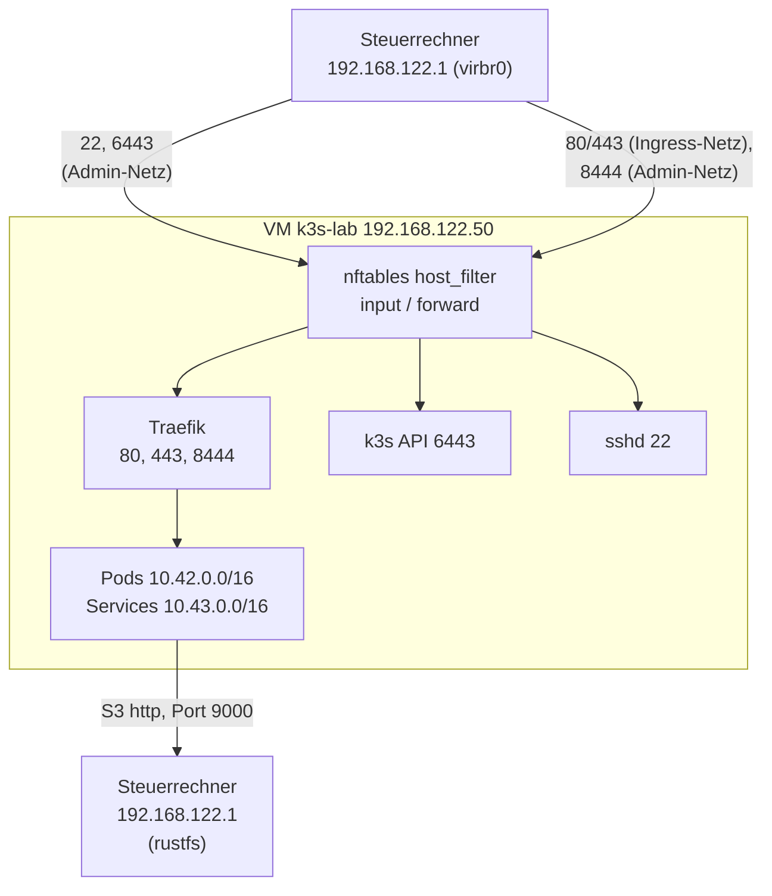

# Referenz: Ports und Netze

Alle Werte stammen aus `lab.yaml`, `group_vars/k3s/main.yml`, der Vorlage
`ansible/roles/firewall/templates/host_filter.nft.j2` und `gitops/platform/traefik/values.yaml`.
Warum die Kante so gebaut ist: [Netz-Kante](../concepts/network-edge.md).

## Netze

| Netz | Wert (Standard) | Quelle | Wer |
|---|---|---|---|
| VM-Netz (libvirt `default`, `virbr0`, NAT) | `192.168.122.0/24`, VM `192.168.122.50`, Gateway/Host `192.168.122.1` | `lab.yaml` (`vm_cidr`, `vm_ip`, `gateway`) | VM und Steuerrechner |
| Admin-Netz | `edge_admin_cidrs` (Standard `vm_cidr`); Profil `edge`: nur `edge_profile_admin` | `lab.yaml` | SSH, API, NodePorts, Admin-Oberfläche |
| Ingress-Netz | `edge_ingress_cidrs` (Standard `vm_cidr`) | `lab.yaml`, nach `gitops/` geschrieben | Apps auf 80/443 |
| Pod-Netz | `10.42.0.0/16` | `k3s_cluster_cidr` | Flannel (`cni0`, `flannel.1`) |
| Service-Netz | `10.43.0.0/16` | `k3s_service_cidr` | ClusterIPs |

## Ports an der VM (von aussen)

| Port | Dienst | Wer darf | Wo erzwungen |
|---|---|---|---|
| 22/tcp | sshd (drop-in-Härtung) | Admin-Netz | Kette `input` |
| 6443/tcp | k3s-API | Admin-Netz | Kette `input` |
| 80/tcp, 443/tcp | Traefik (80 leitet auf `websecure` um) | Ingress-Netz und Admin-Netz | Kette `forward` → `ingress_check` (DNAT-Ziel `ct original proto-dst`), zusätzlich `loadBalancerSourceRanges` am Service |
| 8444/tcp | Traefik-Entrypoint `admin` (Argo CD, whoami) | nur Admin-Netz | Kette `forward` → `admin_check` |
| NodePort 30000–32767, hostPorts, UDP/SCTP-DNAT | gibt es für Traefik nicht (`allocateLoadBalancerNodePorts: false`) | nur Admin-Netz | Kette `forward` → `admin_check` (`firewall_dnat_admin_only: true`) |
| ICMP | Fehlermeldungen; Ping begrenzt auf 10/s | alle | Kette `input` |
| alles andere | verworfen, begrenzt protokolliert | niemand | `input` Policy `drop` |

Log-Präfixe in `journalctl -k`: `host_filter drop: `, `host_filter ingress drop: `,
`host_filter dnat drop: `.

!!! note "Pods nach aussen und Pod zu Pod"
    Die Kette `forward` hat `policy accept`. Sie sperrt nur neue, per DNAT von aussen
    kommende Verbindungen. Pod-zu-Pod- und Pod-nach-aussen-Verkehr bleibt unberührt.
    Der Verkehr innerhalb des Clusters wird von den NetworkPolicies geregelt;
    Egress-Regeln gibt es nur in einzelnen Namespaces (siehe unten, [Issue 37](https://github.com/tabee/k8s-lab-template/issues/37)).

!!! warning "Egress aus `gitea`, `db-lab`, `docs`, `notes-*` und repo-server"
    Hier gilt Default-Deny für Egress ([Issue 5](https://github.com/tabee/k8s-lab-template/issues/5)). Erlaubt ist nur:

    | Von | Nach | Port |
    |---|---|---|
    | alle Pods der Namespaces | kube-dns-Pods | 53 UDP/TCP |
    | Pods im selben Namespace | Pods im selben Namespace (`gitea`, `db-lab`) | alle |
    | Postgres-, Backup-Pods (`cnpg.io/cluster`) | API der VM, S3 des Backup-Ziels | 6443, 9000 |
    | Pooler-Pods | API der VM | 6443 |
    | K8up-Job-Pods | API der VM, S3 des Backup-Ziels | 6443, 9000 |
    | repo-server, `docs`-Builder, `notes-*` | Git-Server (feste Adresse und Port aus `repo_url`) | SSH-Port |
    | repo-server, `docs`, `notes-*` | Internet (Helm, OCI, Pakete) | 443, **offen** (keine Namen in kube-router) |

    **Gitea im Cluster darf nicht nach aussen:** keine Webhooks, keine Mail, keine
    Push-/Pull-Mirrors. Der repo-server erreicht die K8s-API nicht. Die Adresse
    des Git-Servers kommt aus `bash scripts/lab.sh repo-egress --resolve`; ändert
    sie sich, neu auflösen, committen, pushen. Ein einzelnes Ziel erlauben:
    [Fehlersuche](../how-to/troubleshooting.md#egress-gitea).

## Ports im Cluster (von Pods zum Host)

Nur über die CNI-Interfaces (`cni0`, `flannel.1`) und nur aus Pod- und Service-Netz:

| Port | Zweck |
|---|---|
| 6443/tcp | Pods → API (nach DNAT von `10.43.0.1:443`) |
| 10250/tcp | metrics-server → kubelet |

## Der Steuerrechner

| Port | Dienst | Bindung / Regel |
|---|---|---|
| 9000/tcp | rustfs (S3-API, **HTTP**) | ufw: nur aus `192.168.122.0/24` (`virbr0`), sonst deny, auch IPv6 |
| 9001/tcp | rustfs-Konsole | nur `127.0.0.1` |

Die VM erreicht rustfs unter `http://<gateway>:9000`. Die Verbindung ist
unverschlüsselt ([Sicherheitsmodell](../concepts/security-model.md)). In der VM
selbst ist UFW aus; ufw gilt nur für rustfs auf dem Steuerrechner.

## Namen und Zertifikate

`/etc/hosts` auf dem Steuerrechner trägt ein verwalteter Block (Rolle `lab_hosts`,
Marker `# BEGIN/END k8s-lab (Ansible lab_hosts, …)`). Die Namen kommen aus
`spec.dnsNames` der Zertifikate unter `gitops/workloads/*/certificate.yaml`, der
Gitea-`DOMAIN` und dem `host` in `gitops/sites.yaml`.

| Dienst | URL (Standard-Domain) | Port |
|---|---|---|
| Argo CD | `https://argocd.<domain>:8444` | 8444 (Admin) |
| whoami | `https://whoami.<domain>:8444` | 8444 (Admin) |
| Doku | `https://docs.<domain>` | 443 |
| Gitea (nur HTTPS, SSH ist aus) | `https://git.<domain>` | 443 |
| Notiz-Sites | `https://<host aus sites.yaml>` | 443 |

Gitea hat keinen SSH-Dienst (`DISABLE_SSH`); `git clone`/`push` läuft über
HTTPS.
