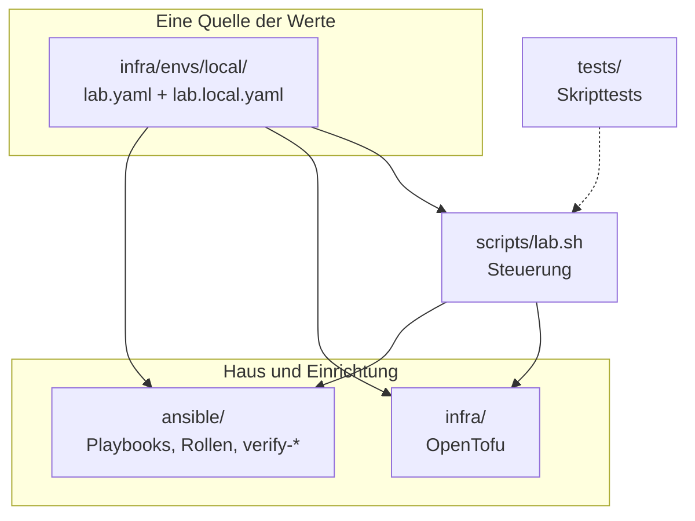
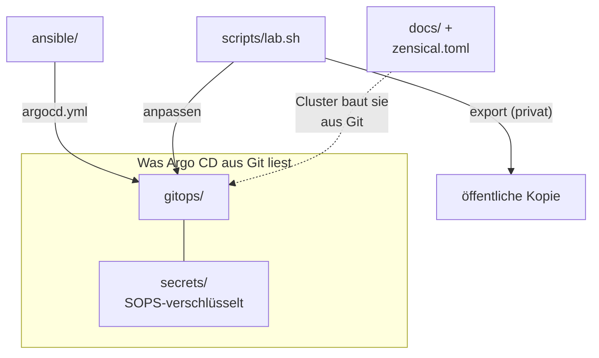

# Referenz: Repository-Aufbau

Eine Karte des Repositorys: was wo liegt, welches Werkzeug es liest und wo es
geprüft wird. Der Ordner `gitops/` hat eine eigene Seite:
[gitops/ (Aufbau und Regeln)](gitops-layout.md).

Die Werte fliessen aus einer Quelle in Steuerung und Einrichtung:

Was Argo CD aus Git liest, und wer es verändert:

## Wurzel

| Pfad | Inhalt | Wer liest es |
|---|---|---|
| `scripts/lab.sh` | die Steuerung: `up`, `down`, `rebuild`, `purge`, `acceptance`, `restore-drill`, `replica`, `alert`, `export`, `init`, `secrets`, `customize`, `gitea-import`, `matrix-import`, `status`, `preflight`, `ca-rotation`, `tools`, `kit` (privat: `public`, `guard`) | du |
| `scripts/gitea-import.sh`, `scripts/gitea-import/` | Gitea-Import: Dump der Produktions-Forge ins Lab-Gitea ([Gitea-Import](../how-to/gitea-import.md)); `gitea-import-vps-dump.sh` läuft auf dem VPS, `gitea-import-e2e.sh` ist der manuelle Test | `lab.sh gitea-import` |
| `scripts/matrix-import.sh`, `scripts/matrix-import/` | Matrix-Import: Dump des Produktions-Synapse ins Lab-Matrix ([Matrix-Import](../how-to/matrix-import.md)); `matrix-import-vps-dump.sh` läuft nur lesend auf dem VPS | `lab.sh matrix-import` |
| `scripts/lab-customize.py` | schreibt die eigenen Werte in die Dateien, die Argo CD aus Git liest | `lab.sh customize` |
| `scripts/install-tools.sh` | Werkzeuge für den Steuerrechner idempotent installieren oder prüfen ([Referenz](control-tools.md)); Pins `ci/control-tools.env`, Python-Lock `ci/requirements-control.txt` | `lab.sh tools install`, `tools check` |
| `scripts/emergency-kit.sh` | Notfall-Kit: alle Schlüssel und Passwörter des Steuerrechners in ein verschlüsseltes Archiv auf einem Stick, prüfen, zurückspielen ([Notfall-Kit](emergency-kit.md)) | `lab.sh kit` |
| `scripts/lab-replica.py` | Backup-Replikat: spiegeln, prüfen, Frische, zurückholen ([Backup-Replikat](../how-to/backup-replica.md)) | `lab.sh replica`, Timer |
| `scripts/lab-alert.py` | Alarme: Prüfungen und Senken ([Alarm](../how-to/alerts.md)) | `lab.sh alert`, Timer |
| `scripts/lab-secrets.py` | Karte der Geheimnisse (Name, Zweck, Fundort, Zustand), nie Werte | `lab.sh secrets`, `acceptance` |
| `scripts/ci-lint.sh` | alle Lint-Regeln an einer Stelle (shellcheck, yamllint, ansible-lint, Helm-Render), gleich lokal und in der CI | du, CI, `wave3-run.sh` |
| `scripts/consistency-check.py` | vergleicht die Kopien in `gitops/` mit ihren Quellen | `verify-consistency.yml` |
| `scripts/memory-budget.py` | Speicherbudget: prüfen, messen, Limits aus Messwerten übernehmen | `verify-budget.yml`, `lab.sh budget` |
| `scripts/pins-online.py` | prüft die Pins gegen die Registries (braucht Netz) | du |
| `scripts/gitleaks-local.sh` | Secret-Scan über die ganze Historie oder nur die gestagten Änderungen | du, CI |
| `scripts/public/` | Regeln, Export und Wächter für die öffentliche Kopie (nur privat) | `lab.sh public`, `lab.sh guard` |
| `zensical.toml` | Konfiguration der Doku-Site (Navigation, Theme, Erweiterungen, Graph) | `docs/build.sh`, Doku-Pod |
| `.sops.yaml` | age-Empfänger und Pfadregel für SOPS | `sops`, KSOPS |
| `AGENTS.md` | Kurzregeln für KI-Agenten und Mitwirkende (englisch): Karte, Befehle, Konventionen, Sicherheitsregeln, Definition von fertig | KI-Agenten, du, `tests/agents-tests.sh` |
| `CLAUDE.md` | zeigt nur auf `AGENTS.md` (eine Quelle, kein zweiter Regelsatz) | KI-Agenten |
| `.gitleaks.toml` | Regeln und Ausnahmen des Secret-Scans | gitleaks |
| `.github/workflows/gitleaks.yml` | CI-Workflow des Secret-Scans (die öffentliche Kopie legt ihn unter `.github/` ab) | Gitea Actions |
| `secrets/README.md` | wie `secrets/` aufgebaut ist | du |

## `infra/` (OpenTofu)

| Pfad | Inhalt |
|---|---|
| `infra/envs/local/lab.yaml` | **alle Werte des Labs** mit Kommentaren ([Konfiguration](configuration.md)) |
| `infra/envs/local/lab.local.yaml.example` | Vorlage für die eigenen Abweichungen (`lab.local.yaml` liegt daneben, nicht im Git) |
| `infra/envs/local/{locals,main,outputs}.tf` | liest `lab.yaml` und `lab.local.yaml`, ruft das VM-Modul |
| `infra/modules/libvirt-vm/` | VM, Platte, Netzanbindung (die Erstkonfiguration kommt aus `cloud-init`) |
| `infra/modules/cloud-init/` | Erstkonfiguration (`user-data.yaml.tftpl`), gemeinsam für alle Umgebungen |
| `infra/envs/<name>/` | weitere Umgebung: nur abweichende Werte in `lab.yaml` ([ADR-0027](../concepts/decisions/0027-environments-one-source.md)) |

## `ansible/`

| Pfad | Inhalt |
|---|---|
| `site.yml` | Rollen `base`, `firewall`, `k3s` auf der VM |
| `argocd.yml` | Argo CD, Lab-CA, SOPS, Doku-Site, Notiz-Sites (läuft auf dem Steuerrechner gegen die k8s-API) |
| `backup-host.yml` | rustfs auf dem Steuerrechner (Rolle `backup_s3`) |
| `public.yml` | öffentliche Probe: Issuer `lab-acme` und ein Zertifikat ausserhalb der Lab-Domain (optional) |
| `backup-replica.yml`, `backup-alert.yml` | Replikat und Alarme auf dem Steuerrechner (Rollen `backup_replica`, `backup_alert`) |
| `restore-drill.yml` | Restore-Test in einem Wegwerf-Namespace ([Restore-Test](../how-to/restore-drill.md)) |
| `lab-backups-empty.yml` | leert die Backup-Buckets vor einem Neuaufbau mit demselben `serverName` |
| `purge-host.yml` | räumt `/etc/hosts`-Block und Kubeconfig auf dem Steuerrechner weg |
| `verify*.yml` | die elf Prüf-Playbooks ([Verify-Playbooks](verify-playbooks.md)) |
| `inventory/local.yml`, `inventory/group_vars/` | Inventory und Variablen; `all/lab.yml` bringt `lab.yaml` als Variable `lab` |
| `roles/` | `base`, `firewall`, `k3s`, `argocd_bootstrap`, `lab_ca`, `lab_acme`, `lab_hosts`, `backup_s3`, `backup_replica`, `backup_alert`, `docs_site`, `notes_sites` |
| `tasks/` | `secrets-generate.yml` (Zufallswerte anlegen), `verify-notes-site.yml` (je Site) |
| `scripts/` | `sops-secret.sh` (Secret verschlüsseln), `lab-ca-trust.sh` (CA im System und in Browsern vertrauen), `cnpg-failover-drill.sh` ([Failover-Übung](../how-to/failover-drill.md)) |
| `requirements.yml` | gepinnte Collections ([Versionen](versions.md)) |

| Rolle | Aufgabe |
|---|---|
| `base` | Pakete, `snapd` entfernen, Unattended-Upgrades, Kernel-Module, `apport` aus, sysctl, SSH-Härtung, auditd, AppArmor, Zeitzone |
| `firewall` | nftables-Tabelle `inet host_filter` (Profile `default` und `edge`) |
| `k3s` | k3s-Installation mit Härtung, Kubeconfig |
| `argocd_bootstrap` | Argo CD, Projekte, Repo-Secret, age-Secret, KSOPS, Root-App |
| `lab_ca`, `lab_acme` | Namespace `cert-manager` mit PSA, Preflight, Warten auf das CA-Secret von Argo CD, öffentliches CA-Zertifikat; `lab_acme`: Issuer `lab-acme` und Probe-Zertifikat (die Richtlinie der Lab-CA liegt in `gitops/platform/cert-manager/manifests/policy-lab-ca-names.yaml`) |
| `lab_hosts` | Namen der VM im Block in `/etc/hosts` des Steuerrechners |
| `backup_s3` | rustfs als rootless Podman-Quadlet, Buckets, Benutzer, ufw, Watchdog |
| `docs_site`, `notes_sites` | Namespace, Repo-Secret und Passwörter der Doku-Site und der Notiz-Sites |

## `gitops/` und `secrets/`

| Pfad | Inhalt |
|---|---|
| `gitops/apps/` | die Applications, die `root` liest |
| `gitops/platform/` | Werte und Manifeste der Plattform-Dienste (Traefik, cert-manager, CNPG, K8up) |
| `gitops/workloads/` | whoami, Argo-CD-Oberfläche, Doku-Site, `db-lab`, Gitea, Matrix, Keycloak, Gitea-Runner |
| `gitops/workloads/gitea-runner/` | Runner für Gitea Actions: Deployment, Konfiguration mit Pod-Vorlage der Jobs, RBAC, Quota und NetworkPolicy der Namespaces `gitea-runner` und `gitea-runner-jobs` ([Gitea Actions](../how-to/gitea-actions.md)) |
| `gitops/charts/notes-site/` | Helm-Chart einer Notiz-Site |
| `gitops/charts/matrix/` | Konfiguration von Synapse und Element Web |
| `gitops/charts/keycloak/` | Realm `lab` als ConfigMap (Clients, Gruppen) |
| `gitops/sites.yaml` | Liste der Notizbücher |
| `gitops/values-state.yaml` | Stand der eigenen Werte in `gitops/` (pflegt `lab.sh customize`, nicht von Hand ändern) |
| `secrets/<namespace>/` | `*.sops.yaml`, `kustomization.yaml`, `ksops.yaml`; Beispiele `*.example` |
| `secrets/gitea-runner/` | Registrierungs-Token des Runners (dasselbe wie `secrets/gitea/gitea-runner-token.sops.yaml`) |

## `tests/`

| Datei | Prüft | Voraussetzung |
|---|---|---|
| `tests/lab-sh-tests.sh` | `lab.sh` mit Attrappen für CLI, Konfiguration und Lebenszyklus (`up`, `down`, `export`, `rebuild`, `purge`, `acceptance`, `customize`, `preflight`) | `bash` |
| `tests/lab-sh-secrets-tests.sh` | `init`, `secrets`, CA-Rotation und Erzeuger der Geheimnisse mit echten Werkzeugen (`sops`, `age`, `openssl`, `ssh-keygen`) | `bash` |
| `tests/lab-sh-restore-tests.sh` | `rebuild --restore`, Quellvertrauen und Git-Spiegel mit Attrappen | `bash` |
| `tests/helpers/lab-sh-sandbox.sh` | Gemeinsame Sandbox und Attrappen der drei `lab.sh`-Suiten; kein eigenständiger Testlauf | `bash` |
| `tests/notes-sso-tests.sh` | Keycloak-Anmeldung der Notizseiten: Chart-Ausgabe (`sso` und `basic`), Keycloak-Client, NetworkPolicies, Speicherbudget, Rolle und Prüfspiele; ein Attrappen-Server für den Ablauf Anmeldung, Gruppe, Abmeldung | `bash`, `python3`, `helm` |
| `tests/gitea-runner-tests.sh` | Gitea Actions und Runner: Werte von Gitea, Isolation der Job-Pods (PSA, kein Token, kein `privileged`), RBAC, NetworkPolicies, Quota, Budget, Kopien von Hostname, Image und Namespaces | `bash`, `python3` (`helm` optional) |
| `tests/agents-tests.sh` | `AGENTS.md` und `CLAUDE.md`: jeder genannte Pfad, jeder `lab.sh`-Unterbefehl und jede Testsuite existiert, Länge, Sprache, nur der Admin-Einstiegspunkt für die Argo-CD-Oberfläche; der Prüfer selbst mit einem Attrappen-Baum | `python3` |
| `tests/install-tools-tests.sh` | Installer mit isoliertem HOME und Attrappen: Versionen, Prüfsummenfehler, Prüfmodus ohne sudo, unveränderter zweiter Lauf und Pin-Konsistenz | `bash`, `python3`, PyYAML |
| `tests/kit-tests.sh` | Notfall-Kit: Hin und zurück mit echtem `age`, fehlende Datei, Ziel im Repo, Rechte, kein Geheimnis in der Ausgabe, `kit-extra.list` | `bash`, `age`, `python3` |
| `tests/public-tests.sh` | Export und Wächter (nur privat; die öffentliche Kopie enthält ihn nicht) | `bash`, `python3` |
| `tests/ca-nameconstraints-tests.sh` | Lab-CA: openssl-Beweise, Go-Client, Rotation mit echtem `sops`/`age`, CEL-Regeln der Richtlinie (celpy optional) | `openssl`, `sops`, `age` |
| `tests/ca-vap-cel-tests.py` | CEL-Regeln der `ValidatingAdmissionPolicy` mit celpy | `pip install cel-python` |
| `tests/firewall-netns-tests.sh` | echte TCP-Verbindungen gegen die nftables-Tabelle in Netzwerk-Namensräumen (Profile `default` und `edge`) | `root` ohne Passwort, `ip`, `nft`, `ansible-playbook`; sonst `SKIP` |

Die Tests berühren weder dein `$HOME` noch einen Cluster.

## `docs/`

Siehe [Doku-Site](../how-to/docs-site.md) und die [Lernreise](../learning-path/index.md).
