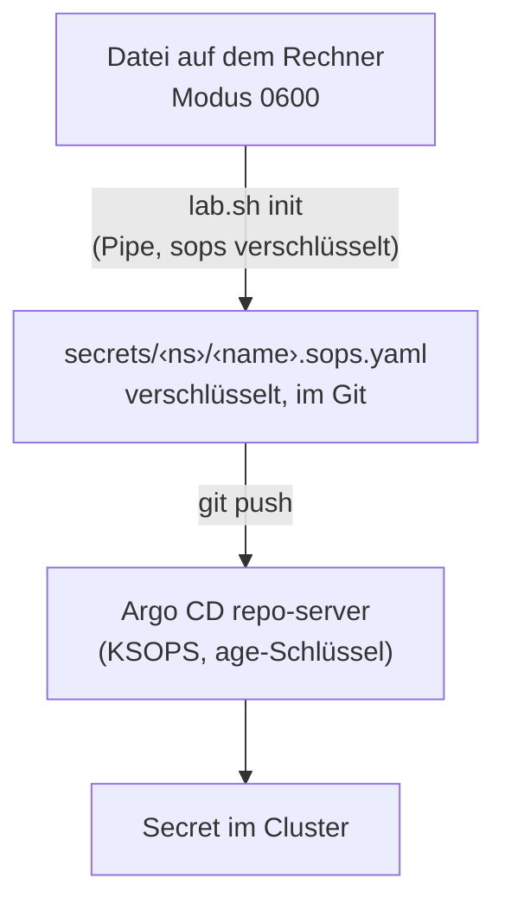

# Geheimnis-Karte: wo liegt was, wer erzeugt es, wer braucht es

!!! danger "Hier stehen nur Pfade und Zwecke, nie Werte"
    Diese Seite und `lab.sh secrets` zeigen nie ein Geheimnis. Wie sie
    entstehen und rotiert werden: [Geheimnisse anlegen und rotieren](../how-to/secrets.md).
    Warum so: [Secret-Fluss](../concepts/secret-flow.md).

Das Lab hat eine Handvoll Geheimnisse (Schlüssel, Passwörter, Zertifikate).
Sie liegen als Dateien auf dem Steuerrechner (Modus 0600), und die
verschlüsselte Kopie für den Cluster steht unter `secrets/*.sops.yaml`.
Dieses Dokument ist die Landkarte dazu. `bash scripts/lab.sh secrets`
druckt dieselbe Karte live, mit den echten Rechten deiner Dateien. Es zeigt
nie einen Wert.

**Eine Quelle:** die Liste aller Geheimnisse steht nur in
`ansible/inventory/group_vars/all/secrets.yml`. `lab.sh init`,
`lab.sh secrets` und Ansible lesen sie von dort. Ein Test
(`tests/lab-sh-tests.sh`) prüft, dass jeder Eintrag der Liste hier steht.

**Ein Generator:** Was `init` und Ansible erzeugen (Passwörter, rustfs-Root,
S3-Zugänge, SSH-Schlüssel), erzeugt allein `scripts/lab-secrets.py`. Die
Ansible-Rollen `backup_s3` und `notes_sites` rufen es über
`ansible/tasks/secrets-generate.yml` auf, `lab.sh init` ruft es direkt auf.
So gibt es ein Format und eine Zufallsquelle. Der Generator legt nur fehlende
Dateien an (`NEU`), vorhandene bleiben (`SKIP`), und er druckt nie einen Wert.
Grenze: Im Ansible-Prüfmodus (`--check`) wird nichts erzeugt, die Rolle
meldet dann nur, was fehlen würde. Der age-Schlüssel bleibt bei `init`.

**Merksatz:** was nicht im Passwort-Manager liegt, ist nach einem
Plattenschaden weg. Sechs Einträge sind darum mit **★** markiert.

## Die Karte

Spalten: Name (so heisst er in der Karte), Zweck, Pfad, wer ihn erzeugt,
wer ihn braucht, was bei einer Rotation zu tun ist. Der Befehl zum Kopieren
steht in der Karte (`wl-copy < Pfad`).

| Name | Zweck | Pfad | Erzeugt von | Verbraucher | Rotation |
|---|---|---|---|---|---|
| `age-key` ★ | SOPS/KSOPS-Schlüssel, entschlüsselt alle `secrets/*.sops.yaml` | `~/.config/sops/age/keys.txt` | `lab.sh init` (`age-keygen`) | `.sops.yaml` (Empfänger), sops, Argo CD (Secret `argocd/sops-age`) | neuer Schlüssel als zweiter Empfänger, `sops updatekeys`, alten entfernen ([Rotation](../how-to/secrets.md#age-schluessel-rotieren)) |
| `break-glass-key` ★ | Offline-age-Schlüssel als zweiter (letzter) Empfänger der SOPS-Dateien; nur für den Notfall, wenn `age-key` verloren ist | `~/.config/k8s-lab/break-glass-age.txt` (Modus 0600; nach dem Passwortmanager löschen) | `lab.sh init --break-glass` (`age-keygen`) | `.sops.yaml` (letzter Empfänger), alle `secrets/**/*.sops.yaml`; **nicht** im Cluster (`argocd/sops-age` enthält nur den Online-Schlüssel) | `lab.sh init --break-glass-delete` (verlangt ein getipptes `delete`), dann neu erzeugen; bei Rotation des Online-Schlüssels diesen **vor** dem Break-Glass-Schlüssel eintragen |
| `lab-ca` ★ | Lab-CA, mit der cert-manager die Zertifikate der Dienste signiert (Secret-YAML mit `ca.crt`, `tls.crt`, `tls.key`) | `~/.config/k8s-lab/lab-ca-secret.yaml` (öffentlich: `lab-ca.crt`, 0644) | `lab.sh init` (`openssl`, EC P-256, 10 Jahre, kritische nameConstraints: nur Namen unter der Lab-Domain) | `secrets/cert-manager/lab-ca.sops.yaml`, ClusterIssuer, Rolle `lab_ca` | `lab.sh ca-rotation` (erzeugt die neue CA, sichert die alte), `lab-ca.crt` neu vertrauen ([CA-Rotation](../how-to/ca-rotation.md)) |
| `acme-token` | API-Token des DNS-Anbieters für die öffentliche Probe (ACME DNS-01). Optional: ohne die Datei bleibt die Probe aus | `~/.config/k8s-lab/acme-dns01.token` (Modus 600, eine Zeile) | Du selbst; `lab.sh init` legt sonst eine SOPS-Datei mit leerem Wert an | `secrets/cert-manager/acme-dns01-token.sops.yaml`, ClusterIssuer `lab-acme`, Rolle `lab_acme` | Token beim Anbieter erneuern, Datei ersetzen, SOPS-Datei löschen, `lab.sh init` ([Öffentliches Zertifikat](../how-to/public-certificate.md)) |
| `rustfs-root` | Root-Schlüssel des S3-Servers rustfs | `~/.config/rustfs/rustfs.env` | `lab.sh init` oder `backup-host.yml` | rustfs, Rolle `backup_s3` | Datei ersetzen, rustfs neu starten, `backup-host.yml` |
| `s3-cnpg` | S3-Zugang der Datenbank-Backups (nur Bucket `cnpg-k3s-lab`) | `~/.config/k8s-lab/s3-cnpg-k3s-lab.env` | `lab.sh init` oder `backup-host.yml` | `secrets/db-lab/backup-s3-creds.sops.yaml`, `secrets/gitea/backup-s3-creds.sops.yaml`, `secrets/matrix/backup-s3-creds.sops.yaml`, `secrets/keycloak/backup-s3-creds.sops.yaml`, rustfs | Datei ersetzen, `backup-host.yml`, SOPS-Dateien neu rendern |
| `s3-k8up` | S3-Zugang der K8up-Backups (nur Bucket `k8up-k3s-lab`) | `~/.config/k8s-lab/s3-k8up-k3s-lab.env` | `lab.sh init` oder `backup-host.yml` | `secrets/gitea/k8up-s3-creds.sops.yaml`, `secrets/matrix/k8up-s3-creds.sops.yaml`, rustfs | Datei ersetzen, `backup-host.yml`, SOPS-Dateien neu rendern |
| `gitea-db-pw` | Passwort des Datenbank-Benutzers von Gitea | `~/.config/k8s-lab/gitea-k3s-lab-db.pw` | `lab.sh init` | `secrets/gitea/gitea-db-owner.sops.yaml` | Datei ersetzen, neu rendern, Passwort in der Datenbank setzen |
| `gitea-admin-user` | Benutzername des Gitea-Admins (Vorgabe `lab-admin`) | `~/.config/k8s-lab/gitea-k3s-lab-admin.user` | `lab.sh init` | `secrets/gitea/gitea-admin.sops.yaml` | Datei ändern, neu rendern |
| `gitea-admin-pw` | Passwort des Gitea-Admins | `~/.config/k8s-lab/gitea-k3s-lab-admin.pw` | `lab.sh init` | `secrets/gitea/gitea-admin.sops.yaml` | Datei ersetzen, neu rendern |
| `gitea-runner-token` | Globales Registrierungs-Token des Gitea-Actions-Runners (mindestens 32 Zeichen, derselbe Wert auf beiden Seiten) | `~/.config/k8s-lab/gitea-k3s-lab-runner.token` | `lab.sh init` | `secrets/gitea/gitea-runner-token.sops.yaml`, `secrets/gitea-runner/gitea-runner-registration.sops.yaml` | in Gitea zurücksetzen, Datei ersetzen, beide SOPS-Dateien neu rendern, Gitea und Runner neu starten ([Gitea Actions](../how-to/gitea-actions.md#token-wechseln)) |
| `k8up-repo-pw` ★ | Passwort der restic-Repos: verschlüsselt die K8up-Backups von Gitea und Matrix (eigenes Repo, Präfix `matrix`), ohne es sind sie unlesbar | `~/.config/k8s-lab/k8up-k3s-lab-repo.pw` | `lab.sh init` | `secrets/gitea/k8up-repo.sops.yaml`, `secrets/matrix/k8up-repo.sops.yaml` | nicht ohne neues restic-Repo (alte Backups brauchen das alte Passwort) |
| `matrix-db-pw` | Passwort des Datenbank-Benutzers von Matrix | `~/.config/k8s-lab/matrix-k3s-lab-db.pw` | `lab.sh init` | `secrets/matrix/matrix-db-owner.sops.yaml` | Datei ersetzen, neu rendern, Passwort in der Datenbank setzen |
| `matrix-admin-user` | Benutzername des Matrix-Admins (Vorgabe `lab-admin`) | `~/.config/k8s-lab/matrix-k3s-lab-admin.user` | `lab.sh init` | `secrets/matrix/matrix-admin.sops.yaml` | Datei ändern, neu rendern |
| `matrix-admin-pw` | Passwort des Matrix-Admins | `~/.config/k8s-lab/matrix-k3s-lab-admin.pw` | `lab.sh init` | `secrets/matrix/matrix-admin.sops.yaml` | Datei ersetzen, neu rendern |
| `matrix-registration-secret` ★ | gemeinsames Geheimnis, mit dem Synapse den Admin anlegt (die Registrierung bleibt aus) | `~/.config/k8s-lab/matrix-k3s-lab-registration.secret` | `lab.sh init` | `secrets/matrix/matrix-registration.sops.yaml` | Datei ersetzen, neu rendern (ein bestehender Admin wird nicht neu angelegt) |
| `matrix-signing-key` ★ | optionaler Signaturschlüssel von Synapse (eine Zeile). Leer: der erste Start erzeugt ihn auf dem Volume, K8up sichert ihn | `~/.config/k8s-lab/matrix-k3s-lab-signing.key` | du, oder der erste Start, wenn die Datei fehlt ([Matrix](../how-to/matrix.md)) | `secrets/matrix/matrix-signing-key.sops.yaml` | nicht ohne neue Homeserver-Identität; ein anderer Schlüssel als auf dem Volume hält den Pod an |
| `keycloak-db-pw` | Passwort des Datenbank-Benutzers von Keycloak | `~/.config/k8s-lab/keycloak-k3s-lab-db.pw` | `lab.sh init` | `secrets/keycloak/keycloak-db-owner.sops.yaml` | Datei ersetzen, neu rendern, Passwort in der Datenbank setzen |
| `keycloak-admin-user` | Benutzername des Keycloak-Start-Admins (Vorgabe `kc-admin`, Realm `master`, nur per Port-Forward erreichbar) | `~/.config/k8s-lab/keycloak-k3s-lab-admin.user` | `lab.sh init` | `secrets/keycloak/keycloak-admin.sops.yaml` | Datei ändern, neu rendern (ein bestehender Admin wird nicht umbenannt) |
| `keycloak-admin-pw` | Passwort des Keycloak-Start-Admins, auch vom Realm-Job genutzt. Gilt nur beim ersten Start: eine spätere Änderung geschieht in der Admin-Konsole | `~/.config/k8s-lab/keycloak-k3s-lab-admin.pw` | `lab.sh init` | `secrets/keycloak/keycloak-admin.sops.yaml` | Datei ersetzen, neu rendern, dann in der Admin-Konsole setzen |
| `keycloak-gitea-client-secret` | Client-Geheimnis des OIDC-Clients `gitea` (derselbe Wert auf beiden Seiten) | `~/.config/k8s-lab/keycloak-k3s-lab-gitea-client.secret` | `lab.sh init` | `secrets/keycloak/keycloak-oidc-clients.sops.yaml`, `secrets/gitea/gitea-oidc.sops.yaml` | Datei ersetzen, beide SOPS-Dateien neu rendern |
| `keycloak-synapse-client-secret` | Client-Geheimnis des OIDC-Clients `synapse` (derselbe Wert auf beiden Seiten) | `~/.config/k8s-lab/keycloak-k3s-lab-synapse-client.secret` | `lab.sh init` | `secrets/keycloak/keycloak-oidc-clients.sops.yaml`, `secrets/matrix/matrix-oidc.sops.yaml` | Datei ersetzen, beide SOPS-Dateien neu rendern |
| `keycloak-notes-client-secret` | Client-Geheimnis des OIDC-Clients `notes` (ein Client für alle Notiz-Sites mit `auth: sso`) | `~/.config/k8s-lab/keycloak-k3s-lab-notes-client.secret` | `lab.sh init` | `secrets/keycloak/keycloak-notes-client.sops.yaml` (Realm-Job), Secret `notes-oidc` in jedem SSO-Notiz-Namespace (`argocd.yml`, Rolle `notes_sites`) | Datei ersetzen, SOPS-Datei neu rendern, pushen, `lab.sh sync-host`; dann den Login-Proxy neu starten |
| `argocd-deploy-key` | privater SSH-Schlüssel, mit dem Argo CD das Git-Repo liest | `~/.ssh/argocd-k8s-lab` (`.pub` daneben) | `lab.sh init` (`ssh-keygen`, ed25519) | Secret `argocd/repo-k8s-lab` (`argocd.yml`), Deploy-Key im Git-Server | neues Paar, `.pub` im Git-Server **nur lesend** eintragen, `argocd.yml` |
| `argocd-secrets-deploy-key` | privater SSH-Schlüssel, mit dem Argo CD das private Secrets-Repo liest; nur wenn `secrets_repo_url` ein eigenes Repo ist ([ADR 0022](../concepts/decisions/0022-private-secrets-repo.md)) | `~/.ssh/argocd-k8s-lab-secrets` (`.pub` daneben) | `lab.sh init` (`ssh-keygen`, ed25519) | Secret `argocd/repo-k8s-lab-secrets` (`argocd.yml`), Deploy-Key im Secrets-Repo | neues Paar, `.pub` im Secrets-Repo **nur lesend** eintragen, `argocd.yml` |
| `replica-ssh-key` | eingeschränkter SSH-Schlüssel des Replica-Spiegels (nur rsync, per `rrsync` in ein Verzeichnis gesperrt, nur aus dem LAN) | `~/.ssh/k8s-lab-replica` (`.pub` daneben) | `lab.sh init` oder `lab.sh replica install` (`ssh-keygen`, ed25519) | `lab-replica.py` (systemd-User-Timer), `authorized_keys` der Replica | Paar löschen, `lab.sh replica install` (neues Paar, ersetzt die Zeile in `authorized_keys`), danach `lab.sh replica verify` |
| `replica-install-key` | dein persönlicher SSH-Schlüssel, nur **einmal** für die Installation des eingeschränkten Schlüssels | `~/.ssh/id_ed25519` | du (das Lab erzeugt oder ändert ihn nicht) | `backup-replica.yml` (nur Installationsschritt) | keine Lab-Rotation nötig, danach braucht ihn nichts mehr |
| `alert-matrix-token` | Zugangstoken des Matrix-Bot-Benutzers für Alarme (SOPS-Datei, nur bei eingeschaltetem Matrix-Ziel). Synapse steht; die Senke bleibt aus, bis dieses Token angelegt ist | `~/.config/k8s-lab/alert-matrix.sops.yaml` | du ([Alarme](../how-to/alerts.md)) | `lab-alert.py` (Ziel `matrix`, entschlüsselt beim Senden mit `sops`) | neues Token im Synapse, neue Datei mit `sops encrypt`, altes Token abmelden |
| `alert-heartbeat-url` | Ping-URL (und optional Fail-URL) des externen Heartbeats, healthchecks.io-kompatibel; SOPS-Datei | `~/.config/k8s-lab/alert-heartbeat.sops.yaml` | du ([Alarme](../how-to/alerts.md)) | `lab-alert.py` (entschlüsselt beim Ping mit `sops`) | neuer Check beim Anbieter, neue Datei mit `sops encrypt`, alten Check löschen |
| `wireguard-server-key` | WireGuard-Privatschlüssel des Produktionsknotens; öffentlicher Teil daneben als `.pub` | `~/.config/k8s-lab/wireguard-server.key` | `lab-secrets.py` (Kind `wireguard`) über die WireGuard-Rolle | Rolle `wireguard` auf dem Knoten | neues Paar, Peer-Pubkey auf dem Steuerrechner aktualisieren, Rolle neu laufen lassen |
| `wireguard-client-key` | WireGuard-Privatschlüssel des Steuerrechners; öffentlicher Teil daneben als `.pub` | `~/.config/k8s-lab/wireguard-client.key` | `lab-secrets.py` (Kind `wireguard`) über die WireGuard-Rolle | Rolle `wireguard` auf dem Steuerrechner | neues Paar, Peer-Pubkey auf dem Knoten aktualisieren, Rolle neu laufen lassen |
| `vm-ssh-key` | SSH-Zugang zur Lab-VM (ohne Passphrase) | der Pfad `ssh_key` aus `lab.yaml` (Standard: `~/.ssh/id_ed25519`) | `lab.sh init` (`ssh-keygen`, ed25519) | cloud-init der VM, Ansible | neues Paar, VM neu aufbauen (`rebuild`) |
| `argocd-admin` | initiales Admin-Passwort von Argo CD, liegt nur im Cluster | keine Datei | Argo CD beim ersten Start | Argo-Weboberfläche | in Argo CD ändern |
| `kubeconfig` | Zugang zum Cluster | `~/.kube/k3s-lab.kubeconfig` (`k3s_kubeconfig_local_path`) | `up` (`site.yml`, Rolle `k3s`), nicht `init` | kubectl, Ansible | entsteht beim Neuaufbau neu |

Nach einem Matrix-Import schreibt `lab.sh matrix-import prepare` die Datei `matrix-signing-key` aus dem Dump (nie als Klartext in Git, nur über SOPS; siehe [Matrix-Import](../how-to/matrix-import.md)).

Dazu kommt pro Notiz-Site aus `gitops/sites.yaml` je ein Paar, mit dem
Namenspräfix `notes-` (Namespace-Präfix der Rolle):

| Name | Zweck | Pfad | Erzeugt von |
|---|---|---|---|
| `notes-<site>-deploy` | Deploy-Key der Site (nur lesend eintragen) | `~/.ssh/notes-<site>-deploy` | `lab.sh init` oder Ansible `argocd.yml` (Rolle `notes_sites`) |
| `notes-<site>-cookie` | Schlüssel des Sitzungs-Cookies des Login-Proxys (`auth: sso`, Vorgabe), 32 Zeichen | `~/.config/k8s-lab/notes-<site>.cookie` | `lab.sh init` oder Ansible `argocd.yml` (Rolle `notes_sites`) |
| `notes-<site>-pw` | Passwort der Site, **nur** bei `auth: basic` (Notausgang) | `~/.config/k8s-lab/notes-<site>.passwort` | `lab.sh init` oder Ansible `argocd.yml` (Rolle `notes_sites`) |

`<site>` ist der Name aus `gitops/sites.yaml`. Die Karte zeigt sie einzeln.

Kopieren von Argo CD (liegt nicht auf dem Rechner, kommt aus dem Cluster):

```bash
kubectl --kubeconfig <kubeconfig> -n argocd get secret argocd-initial-admin-secret -o jsonpath='{.data.password}' | base64 -d | wl-copy
```

## Wie ein Geheimnis in den Cluster kommt



Die Vorlage jeder SOPS-Datei ist `secrets/<ns>/<name>.sops.yaml.example`
(Platzhalter, keine Werte). `init` fuellt sie beim Rendern aus den
Host-Dateien und verschlüsselt sofort. Klartext läuft nur durch eine Pipe,
nie auf die Platte und nie ins Repo.

## lab.sh init

```bash
bash scripts/lab.sh init --dry-run                 # zeigt nur, was passieren wuerde
bash scripts/lab.sh init                           # legt fehlende Dateien an, rendert SOPS-Dateien
bash scripts/lab.sh init --new-age-key    # zusaetzlich: eigenen Schluessel in .sops.yaml eintragen
bash scripts/lab.sh init --break-glass             # zweiter, Offline-age-Schluessel als letzter Empfaenger (umkehrbar ueber Git)
```

Regeln, die immer gelten:

- **Nichts wird überschrieben.** Jede vorhandene Datei bleibt (`SKIP`).
  Eine fehlende wird mit Modus 0600 angelegt (Ordner 0700).
- **Zweiter Lauf = alles SKIP.** Gleiche Eingaben, gleicher Zustand.
- **Fehlt eine Host-Datei, aber die SOPS-Datei ist mit Deinem Schlüssel
  lesbar,** holt `init` den Wert aus ihr zurück (`WIEDERHERGESTELLT`),
  statt einen neuen zu erfinden. Das ist der Weg nach einem Plattenschaden
  mit gerettetem age-Schlüssel.
- **Eine vorhandene SOPS-Datei mit anderem Inhalt als die Host-Dateien**
  wird nie geändert. `init` meldet `ABBRUCH` und nennt die Datei. Entscheide
  selbst: Host-Datei oder SOPS-Datei ist die richtige (dann die andere
  löschen und `init` erneut).
- **`.sops.yaml` ändert nur `--new-age-key`.** Er ersetzt den
  einen Empfänger durch Deinen age-Schlüssel (nach Rückfrage, `--yes`
  überspringt sie). Bereits verschlüsselte Dateien für den alten Schlüssel
  bleiben dann unlesbar: `init` meldet sie und löscht nie.
- **Der Argo-Deploy-Key** wird erzeugt, und `init` druckt nur den
  öffentlichen Teil samt Anleitung: im Git-Server als Deploy-Key
  **nur lesend** eintragen. Der private Teil wird nie gezeigt.
- Zum Schluss druckt `init` die Karte. Auch `rebuild` und `acceptance` tun das.

Prüfen Deines bestehenden Setups ohne Risiko: `bash scripts/lab.sh init --dry-run`.
Auf einem vollständigen Setup meldet er nur `SKIP`.

## Was gehört Dir, was dem Autor

Zum Nachbauen auf einem fremden Rechner muss ausgetauscht werden, was an den
Autor gebunden ist. Der Rest ist generisch.

| Wert | Wo | Wer ihn ändert |
|---|---|---|
| age-Empfänger (`age1...`) | `.sops.yaml` | `init` (ersetzt den Platzhalter der öffentlichen Fassung selbst; bei fremden Empfängern mit `--new-age-key`) |
| `secrets/**/*.sops.yaml` | Repo | `init` rendert sie neu (nach dem Entfernen der alten) |
| Notes-Content-Host-Keys (öffentlich) | `gitops/sites.yaml`: `repo_known_hosts` je Site; Ansible schreibt `notes-repo/known_hosts` | Unabhängig von der Argo-Codequelle; Fingerprints separat prüfen, dann `ansible-playbook argocd.yml` ausführen |
| Repo-Adresse, Host-Keys des Git-Servers | `lab.local.yaml` (`repo_url`, `repo_known_hosts`); Kopien in `gitops/` | `lab.sh customize` und `customize --fetch-host-keys`, siehe [Lab für Freunde](../tutorials/lab-for-friends.md) |
| SSH-Benutzer, Domain, Netz | `infra/envs/local/lab.local.yaml` | von Hand, eine Datei; `lab.sh customize` zieht die Kopien in `gitops/` nach |
| Notiz-Sites | `gitops/sites.yaml` | von Hand |

## Verwandt

- [Lab für Freunde](../tutorials/lab-for-friends.md): der Weg für einen Freund
- [Neuaufbau](../how-to/rebuild.md): `up`, `rebuild`, `acceptance`
- [Stufe 7: KSOPS](../learning-path/stage-7-ksops.md): Rotation des age-Schlüssels
- [Sicherheitsmodell](../concepts/security-model.md): was die Geheimnisse schützen und was nicht
