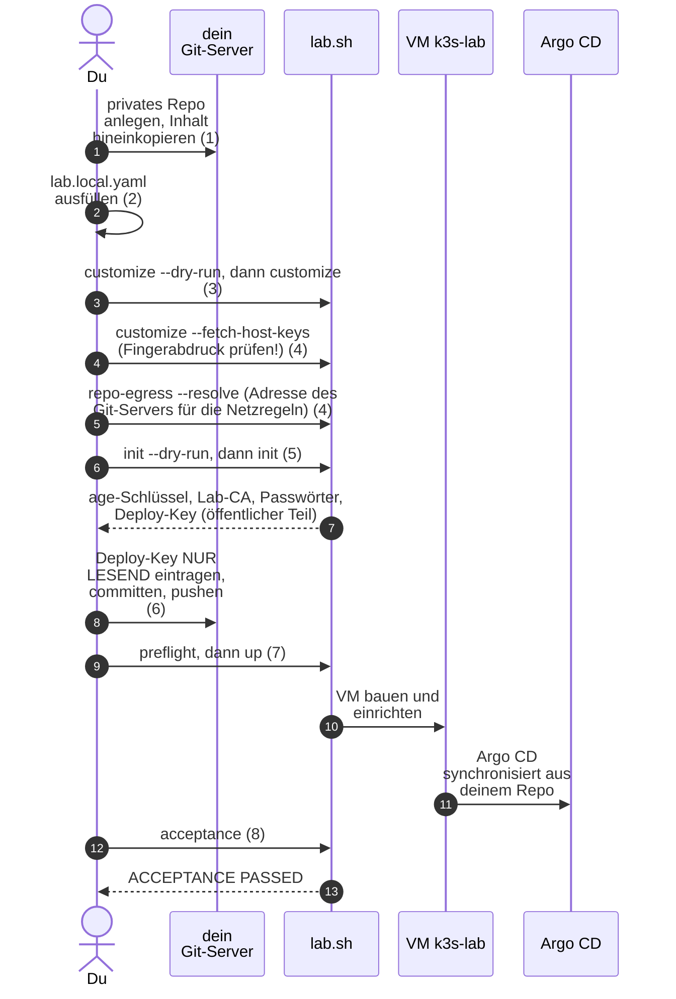

# Lab für Freunde: Schritt für Schritt nachbauen

**Was:** Die Anleitung für jemanden (zum Beispiel einen Freund), der dieses
Lab auf seinem eigenen Linux-PC nachbauen will, mit seinen eigenen Schlüsseln,
seinem eigenen Git-Server und, wenn nötig, in einem anderen Netz. Der Betrieb
danach (`scripts/lab.sh`) steht in [Neuaufbau](../how-to/rebuild.md).

**Warum:** Das Lab ist für einen PC gebaut worden. Einiges darin gehört
nur diesem PC: Schlüssel, Zugang zum Git-Server, Domain, Netz. Die
öffentliche Fassung des Repos enthält davon nichts Echtes, nur neutrale
Platzhalter. Diese Seite sagt, was du an welcher Stelle einsetzt, damit du nichts
suchen musst und keinen fremden Schlüssel weiterbenutzt.

!!! warning "Was es nicht kann"
    Der Weg ist sorgfältig zusammengestellt und **auf dem PC des Autors**
    durchgespielt. Windows und macOS gehen nicht (libvirt/KVM unter Linux). Die
    Schritte bis vor die VM (Pakete, Werkzeuge, `customize`, `init`, `preflight`,
    Testsuiten) sind zusätzlich in einem frischen Ubuntu-24.04-Userland geprüft.
    Die VM selbst (`up`, `acceptance`) wurde nur auf dem PC des Autors gebaut
    ([Issue 26](https://github.com/tabee/k8s-lab-template/issues/26)).

## Der Weg im Überblick



## Das Prinzip: eine Quelle, ein Befehl

Argo CD liest nur Git und kennt weder Ansible noch `lab.yaml`. Darum stehen
Domain, Repo-Adresse und Netz an wenigen Stellen **auch** in `gitops/`. Du
pflegst sie trotzdem nur an einer Stelle:

| Du pflegst | Datei | Wer liest es |
|---|---|---|
| Domain, Repo-Adresse, Host-Keys, Netz, SSH-Schlüssel, RAM | `infra/envs/local/lab.local.yaml` (steht in `.gitignore`) | OpenTofu, Ansible, `lab.sh` |
| die Kopien für Argo CD | `gitops/`, `zensical.toml` | schreibt `lab.sh customize` (nie von Hand) |

`bash scripts/lab.sh customize` ist idempotent: es schreibt nur, was vom Soll
abweicht, merkt sich den Stand in `gitops/values-state.yaml` und meldet sonst
`SKIP`. Der Preflight bricht ab, wenn `gitops/` nicht zu deiner Konfiguration
passt. So bleiben die Kopien gleich der Quelle.

## Überblick

| Was | Wo |
|---|---|
| Hardware, Pakete, Werkzeuge, ufw, podman, libvirt-Gruppen | [Voraussetzungen auf Ubuntu 24.04](#voraussetzungen) (Preflight-Liste: [Neuaufbau](../how-to/rebuild.md#voraussetzungen-und-preflight)) |
| Eigenes **privates** Repo auf deinem Git-Server | Schritt 1 |
| Eigene Werte | Schritt 2 (`lab.local.yaml`) |
| Domain und Repo-Adresse in `gitops/` | Schritt 3 (`customize`) |
| Host-Keys und Adresse des Git-Servers | Schritt 4 (`customize --fetch-host-keys`, `repo-egress --resolve`) |
| age-Schlüssel, Lab-CA, Passwörter, S3, Deploy-Key, SOPS-Dateien | Schritt 5 (`init`) |
| Deploy-Key im Git-Server eintragen, pushen | Schritt 6 |
| Bauen und prüfen | Schritt 7 und 8 (`up`, `acceptance`) |

## Voraussetzungen auf Ubuntu 24.04 {#voraussetzungen}

Diese Liste ist aus dem Code abgeleitet (Preflight in `scripts/lab.sh`, die
Rollen unter `ansible/roles/`, `ansible/requirements.yml`, `scripts/lab-secrets.py`)
und mit den Paketlisten von Ubuntu 24.04 (noble) verglichen. Sie wurde **nicht** auf
einem frisch installierten Ubuntu durchgespielt, die Pakete und Werkzeuge unten aber
in einem frischen Ubuntu-24.04-Userland (ohne VM). Der Preflight (`lab.sh preflight`)
prüft die Werkzeuge (auch `sops`, `age`, `age-keygen`, `podman` und `ufw`), die
libvirt-Dinge, den Git-Stand und die Dateien unter `gitops/`. Nicht prüft er, ob
`ufw` aktiv ist (das fällt erst in `up` auf) und ob `openssl` da ist (das braucht `init`).

**Hardware.** Ein x86_64-PC mit Virtualisierung (Intel VT-x oder AMD-V, im BIOS
eingeschaltet; `/dev/kvm` muss existieren). Das VM-Image in `lab.yaml` ist
`amd64`; eine andere Architektur braucht andere Pins. Standardmässig bekommt die VM
8 GiB RAM (gleich viel wie der geplante Produktionsserver, siehe
[Memory-Budget](../reference/memory-budget.md#prod-paritaet)), 4 vCPU und 60 GB Platte (`memory_mib`, `vcpu`, `disk_gb`); rechne für den
PC mit mindestens 16 GiB RAM. Freier Platz: im libvirt-Pool mindestens
`disk_gb / 2 + 5` GiB (30 GB + 5 = 35 GiB bei den Standardwerten) und im
Export-Ordner mindestens 20 GiB. Internet ist nötig (Image, Charts, Pakete). Der
Benutzer braucht `sudo`: `up` schreibt `/etc/hosts`, die ufw-Regel für rustfs und
schaltet `linger` ein.

**Werkzeuge automatisch einrichten.** Nach dem Klonen oder Entpacken der Quellen
richtet das Skript apt-Pakete, Release-Binaries, pipx und die Ansible-Collections ein.
So braucht auch ein neu aufgesetzter PC dieselbe Werkbank, ohne einzelne Werkzeuge
von Hand zusammenzusuchen ([Referenz](../reference/control-tools.md)).

```bash
export PATH="$HOME/.local/bin:$PATH"
bash scripts/lab.sh tools check
bash scripts/lab.sh tools install
bash scripts/lab.sh tools install
```

Die erste Prüfung meldet auf einem leeren PC Fehler (Exit 1). Der zweite
Installationslauf muss `changes 0` zeigen. Nur apt benötigt sudo; die Binaries
liegen unter `~/.local/bin`. **Eselsbrücke:** erst die Werkbank, dann das Haus.
Das Skript ersetzt keine bewusste Host-Konfiguration:

**Gruppen und Dienste.** Du musst in den Gruppen `kvm` und `libvirt` sein (danach
neu anmelden):

```bash
sudo usermod -aG kvm,libvirt "$USER"
```

Der Preflight verlangt, dass das libvirt-Netz `default` (192.168.122.0/24) aktiv ist
und der Speicherpool `default` läuft. Ubuntu legt das Netz an; den Pool legt es
**nicht immer** an. Zeigt `virsh -c qemu:///system pool-list --all` keinen Pool
`default`, lege ihn an:

```bash
virsh -c qemu:///system pool-define-as default dir --target /var/lib/libvirt/images
virsh -c qemu:///system pool-build default
virsh -c qemu:///system pool-start default
virsh -c qemu:///system pool-autostart default
```

**ufw muss aktiv sein.** rustfs lauscht auf `0.0.0.0:9000`; die Rolle `backup_s3`
bricht ab, wenn ufw fehlt oder nicht aktiv ist, weil das Backup-Ziel sonst im ganzen
LAN offen wäre (siehe [Sicherheitsmodell, R20](../concepts/security-model.md#restrisiken)).
Prüfe mit `sudo ufw status` (muss `Status: active` zeigen); einschalten mit
`sudo ufw enable`. **Achtung:** Ist SSH auf dem PC die einzige Verbindung, erlaube
es zuerst (`sudo ufw allow OpenSSH`), sonst sperrst du dich aus.

**podman ab 4.5.** rustfs läuft als rootless Podman-Quadlet. Ubuntu 24.04 liefert
podman 4.9, das genügt; die Rolle prüft die Version und den Quadlet-Generator
(`/usr/libexec/podman/quadlet`). Ein Betrieb als `root` oder mit `sudo ansible-playbook`
ist **nicht** vorgesehen.

| Werkzeug | Zweck | Installation |
|---|---|---|
| OpenTofu | VM bauen | `tools install`, Pin in `ci/control-tools.env` |
| ansible-core ab 2.17 und Python-Pakete `kubernetes`, `jsonpatch` | Host und Cluster einrichten | zusammen im pipx-Environment |
| Ansible-Collections | Module für Rollen und Kubernetes | aus `ansible/requirements.yml` |
| kubectl passend zu k3s, Helm v4 | Cluster bedienen und Argo CD installieren | SHA-256-geprüfte Releases |
| SOPS, age, age-keygen | Geheimnisse und Notfall-Kit | SHA-256-geprüfte Releases |
| libvirt, QEMU, Podman, ufw, SSH, Python und Hilfsprogramme | Host-Anbindung und Backups | fehlende Ubuntu-Pakete über apt |
| Argo-CD-CLI, helm-diff | optionale Bedienung / Vergleiche | nicht nötig für den Aufbau, nicht automatisch installiert |

**Manueller Rückweg:** bei besonderen Paketquellen die Liste in
[Werkzeuge des Steuerrechners](../reference/control-tools.md) verwenden und dieselben
Pins und Hashes prüfen. Ansible bleibt in pipx, `kubernetes` im selben Environment;
anschliessend `tools check` ausführen. Keine fremden Installationsskripte blind ausführen.

## 1. Eigenes privates Repo

Kopiere den Inhalt dieses Repos in ein **neues, privates** Repo auf deinem
Git-Server (Gitea, GitLab, GitHub). Privat, weil dort später deine
verschlüsselten Secrets, deine Domain und deine Adressen liegen. Auch wenn
SOPS sie verschlüsselt: Es gibt keinen Grund, sie öffentlich zu machen.

```bash
git clone <adresse-dieses-repos> k8s-lab
cd k8s-lab
git remote set-url origin ssh://git@git.example.org/YOUR-NAME/k8s-lab.git
git branch -M main    # Argo CD und der Preflight erwarten den Zweig main
```

Hast du das Repo als Archiv (ZIP oder `tar`) statt als Klon, gibt es noch kein Git:

```bash
cd k8s-lab
git init -b main
git add -A
git commit -m "Start"
git remote add origin ssh://git@git.example.org/YOUR-NAME/k8s-lab.git
```

Die Adresse `git.example.org/YOUR-NAME` ist ein **Platzhalter**: Setze deine echte
Adresse ein, sonst bricht der Preflight ab.

Argo CD braucht nur **lesenden** Zugriff (Deploy-Key, Schritt 6). Schreibzugriff
bekommt es nie.

## 2. Eigene Werte in einer Datei

```bash
cp infra/envs/local/lab.local.yaml.example infra/envs/local/lab.local.yaml
$EDITOR infra/envs/local/lab.local.yaml
```

Nur Schlüssel eintragen, die von `lab.yaml` abweichen. Pflicht ist:

```yaml
domain: meinlab.local                       # Name im Heimnetz, kein echter Eintrag
repo_url: ssh://git@git.example.org/YOUR-NAME/k8s-lab.git   # dein Repo aus Schritt 1
ssh_user: dein-benutzer                     # Benutzer in der VM
ssh_key: ~/.ssh/id_ed25519                  # dein privater Schluessel, <ssh_key>.pub geht per cloud-init in die VM
```

Häufig sonst: `memory_mib`, `vcpu`, `disk_gb`, `vm_ip`, `vm_cidr`, `gateway`,
`dns_servers`, `image_cache_dir`, `export_dir`. Ein Tippfehler im
Schlüsselnamen fällt auf: `lab.sh` bricht ab, wenn `lab.local.yaml` einen
Schlüssel enthält, den `lab.yaml` nicht kennt.

Hast du noch keinen SSH-Schlüssel: `ssh-keygen -t ed25519 -f ~/.ssh/id_ed25519 -C lab`.
Fehlt die Datei, erzeugt `init` das Paar selbst (ed25519, ohne Passphrase). Hat dein
eigener Schlüssel eine Passphrase, lade ihn vorher in den `ssh-agent` (`ssh-add`):
`lab.sh` verbindet sich mit `BatchMode=yes` und kann nie nach einer Passphrase fragen,
und auch Ansible hat dafür keinen Weg.

In `ansible/inventory/local.yml` zeigt `ansible_become_exe` auf das `sudo` deines
PCs. In der öffentlichen Fassung steht dort `/usr/bin/sudo`, der übliche Pfad;
prüfe mit `command -v sudo`, ob er auf deinem System stimmt.
Gehörst du zu den Gruppen `kvm` und `libvirt`, ist sonst nichts nötig.

## 3. Domain und Repo-Adresse nach `gitops/` schreiben

Zuerst ansehen, was passieren würde (schreibt nichts):

```bash
bash scripts/lab.sh customize --dry-run
```

Dann schreiben:

```bash
bash scripts/lab.sh customize
```

Das ersetzt Domain, Repo-Adresse, Gateway und VM-Netz in `gitops/` und
`zensical.toml` und schreibt `gitops/values-state.yaml`. Ein zweiter Lauf meldet
`SKIP`. Ändert sich später ein Wert in `lab.local.yaml`, läuft derselbe
Befehl noch einmal; danach `git diff` ansehen, committen und pushen (Argo CD
liest nur den Stand im Git-Server).

Ist `repo_url` noch der Platzhalter (eine Adresse mit `example.org` oder `YOUR-NAME`),
bricht der Preflight ab.

Optional, ebenfalls in `lab.local.yaml`: das Netz für SSH, API und Admin-Oberfläche
(`edge_admin_cidrs`), das für Apps (`edge_ingress_cidrs`) und das Profil `edge`
([Netz-Kante einstellen](../how-to/edge-profile.md)), sowie die öffentliche Probe
(`acme_*`, [Öffentliches Zertifikat](../how-to/public-certificate.md)). Ohne diese Werte
läuft alles im LAN-Profil, und die Probe ist ein `SKIP`.

## 4. Host-Keys deines Git-Servers

Ohne Host-Keys vertraut Argo CD dem Git-Server nicht, und der Preflight bricht
ab (kein Blindvertrauen). Der Befehl holt die Keys per `ssh-keyscan` und
schreibt sie nach Rückfrage `[y/N]` (mit `y` bestätigen) als `repo_known_hosts` in
`lab.local.yaml`:

```bash
bash scripts/lab.sh customize --fetch-host-keys
```

Das ist ein Vertrauen beim ersten Mal (TOFU): Ein Angreifer im Netz könnte dir
in diesem Moment falsche Keys unterschieben. Vergleiche die angezeigten
Fingerabdrücke mit denen deines Git-Servers (Webseite oder Admin), bevor du
mit `y` bestätigst.

Danach die Adresse des Git-Servers für die Netzregeln des Clusters eintragen. Die
NetworkPolicies können keinen Hostnamen nennen, nur IP-Bereiche. Der Befehl löst
den Namen aus `repo_url` per DNS auf, schreibt `repo_egress_cidrs` in
`lab.local.yaml` und die Regeln unter `gitops/` (braucht Netz; idempotent):

```bash
bash scripts/lab.sh repo-egress --resolve
```

Ohne diesen Schritt meldet der Preflight `egress policies do not match lab.yaml`.
Ändert sich später die Adresse des Git-Servers, läuft derselbe Befehl noch einmal.

## 5. Eigener Schlüsselbund: `init`

Dieses Repo enthält **keine** echten Secrets, nur Vorlagen
(`secrets.example/*/*.sops.yaml.example`; `init` legt daraus `secrets/` an). `lab.sh init` erzeugt deinen Schlüsselbund:
age-Schlüssel, Lab-CA, Passwörter, S3-Zugänge, Argo-Deploy-Key und alle
SOPS-Dateien. Die Liste und die Erklärung jedes Geheimnisses steht in
[Geheimnis-Karte](../reference/secrets-map.md) und [Geheimnisse](../how-to/secrets.md).

Zuerst ansehen (schreibt nichts):

```bash
bash scripts/lab.sh init --dry-run
```

Dann anlegen:

```bash
bash scripts/lab.sh init
```

In `.sops.yaml` steht ein Platzhalter. `init` ersetzt ihn durch den
öffentlichen Teil deines eigenen age-Schlüssels (ohne Rückfrage, weil dort
noch kein echter Schlüssel steht). Stehen dort schon fremde Empfänger, fragt
`init` und braucht `--new-age-key`.

`init` ist idempotent: ein zweiter Lauf meldet nur `SKIP`, und eine vorhandene
Datei wird nie überschrieben. `bash scripts/lab.sh secrets` zeigt
jederzeit die Karte (Pfad, Rechte, Kopierbefehl, nie Werte).

Vier Dinge legst du in deinen Passwort-Manager (in der Karte mit ★ markiert):
den privaten age-Schlüssel, den Break-Glass-Schlüssel (`break-glass-key`), die
Lab-CA und das restic-Repo-Passwort (`k8up-repo-pw`). Ohne sie ist jedes Backup
nutzlos.

## 6. Deploy-Key eintragen, committen, pushen

1. `init` druckt den öffentlichen Teil des Argo-CD-Deploy-Keys
   (`~/.ssh/argocd-k8s-lab.pub`). Trage ihn in deinem Git-Server als
   Deploy-Key **nur lesend** ein. Dasselbe gilt für Deploy-Keys von
   Notiz-Sites, falls du welche benutzt.
2. Committen und pushen, in dein **privates** Repo:

   ```bash
   git add -A
   git status        # nur .sops.yaml, secrets/**/*.sops.yaml, gitops/, lab.yaml-Aenderungen
   git commit -m "Eigene Werte und verschluesselte Secrets"
   git push origin main
   ```

   Prüft vor dem Push: In `git status` darf kein privater Schlüssel stehen
   (`*.sops.yaml` ist verschlüsselt, `lab.local.yaml` steht in `.gitignore`).

## 7. Preflight und Aufbau

```bash
bash scripts/lab.sh preflight   # alles Rote beheben
bash scripts/lab.sh up
```

Der Preflight prüft am Ende mit `git ls-remote`, ob der Deploy-Key dein Repo
wirklich lesen kann, und ob `gitops/` zu `lab.local.yaml` passt.

Die Namen der Dienste trägt `up` selbst in einen verwalteten Block in
`/etc/hosts` ein (Rolle `lab_hosts` im Schritt `backup-host.yml`, braucht
`sudo`).

### Danach: Browser der Lab-CA vertrauen {#ca-vertrauen}

Erst jetzt, **nach** `up`, lässt du deinen Browser der Lab-CA vertrauen
([Lab-CA vertrauen](../how-to/trust-lab-ca.md)), und zwar vor dem ersten Aufruf einer
Dienst-Adresse im Browser. Früher geht es nicht, aus einem Grund im Code: Die
öffentliche CA-Datei `~/.config/k8s-lab/lab-ca.crt` entsteht erst in `argocd.yml`,
einem Schritt von `up`. Vor `up` gibt es nichts zu vertrauen. Bis dahin braucht
auch nichts im Tutorial ein vertrauenswürdiges Zertifikat: Die Prüfungen von
`lab.sh` und Ansible nutzen `curl --cacert` mit dieser CA-Datei und brauchen den
Browser nicht. Der erste Browser-Aufruf ohne Vertrauen zeigt eine
Zertifikatswarnung; bestätige sie nicht, sondern führe zuerst die Schritte der
Anleitung aus (Fingerabdruck vergleichen).

## 8. Abnahme

```bash
bash scripts/lab.sh acceptance
```

Am Ende steht `ACCEPTANCE PASSED` (Exit 0) oder `ACCEPTANCE NOT PASSED` mit der roten Phase.

Die [Abnahme](../how-to/acceptance.md) sichert ein Dummy-Repo und eine
Dummy-Tabelle, löscht sie, stellt sie wieder her und vergleicht. Grün heisst: Das Lab trägt, und die Backups
funktionieren.

Beim ersten Mal gibt es noch keine VM und nichts zu exportieren. Ab dem ersten
Lauf gilt die Export-Pflicht vor jedem `down`, `rebuild` und `purge`, damit das
Haus fallen darf und der Werkzeugschuppen bleibt.

## Notiz-Sites (optional)

`gitops/sites.yaml` ist leer ausgeliefert. Wer Notizbücher als Site
veröffentlichen will, trägt dort eigene Einträge ein (Format im Kopf der
Datei, Hintergrund in [Notiz-Sites](../how-to/notes-sites.md)). Namespace,
Deploy-Key und Passwort jeder Site legt Ansible an; die Geheimnisse erzeugt der
gemeinsame Generator `scripts/lab-secrets.py` (derselbe Code wie `init`).

## Anderes Netz {#anderes-netz}

Standard ist das libvirt-Netz `192.168.122.0/24`. Ist deines ein anderes, setze
in `lab.local.yaml` `vm_ip`, `vm_cidr`, `gateway` und `dns_servers` und führe
`bash scripts/lab.sh customize` aus. Es ersetzt die Adressen in diesen Dateien
(Argo CD liest `lab.yaml` nicht):

| Datei | Was dort steht | Wofür |
|---|---|---|
| `gitops/workloads/db-lab/objectstore.yaml` | `http://<gateway>:9000` | CNPG (pg-lab) erreicht rustfs auf dem PC |
| `gitops/workloads/gitea/manifests/objectstore.yaml` | `http://<gateway>:9000` | CNPG (gitea-db) erreicht rustfs |
| `gitops/workloads/gitea/manifests/k8up-schedule.yaml` | `http://<gateway>:9000` | K8up erreicht rustfs |
| `gitops/platform/traefik/values.yaml` | `<vm_cidr>` | Traefik vertraut Weiterleitungs-Kopfzeilen nur aus dem VM-Netz |

Hinweise:

- Das libvirt-Netz muss wirklich diese Adresse haben (`virsh net-dumpxml
  default`); der Preflight prüft das Gateway.
- Weitere Stellen mit der alten Adresse sind nur Kommentare (die
  `/etc/hosts`-Beispiele in den IngressRoutes, die Hinweise in den
  NetworkPolicies).
- Die Firewall der VM (nftables-Tabelle `host_filter`) und die ufw-Regel des PCs für rustfs folgen `vm_cidr` und
  `gateway` automatisch (`group_vars/k3s/main.yml`,
  `group_vars/all/backup_s3.yml`).

## Reihenfolge in Kurzform

1. [Voraussetzungen](#voraussetzungen): Pakete, Werkzeuge, Gruppen `kvm` und `libvirt`, ufw aktiv.
2. Eigenes privates Repo (Schritt 1), `lab.local.yaml` (Schritt 2).
3. `bash scripts/lab.sh customize`, dann `bash scripts/lab.sh customize --fetch-host-keys`
   und `bash scripts/lab.sh repo-egress --resolve`.
4. `bash scripts/lab.sh init`, Deploy-Key eintragen, committen, pushen.
5. `bash scripts/lab.sh preflight`, `up`, `acceptance`.

## Wenn etwas nicht klappt

| Meldung | Ursache und Ausweg |
|---|---|
| Preflight: `repo_url is still the placeholder` | `repo_url` in `lab.local.yaml` setzen, dann `customize` |
| Preflight: `gitops/ does not match lab.yaml` | `bash scripts/lab.sh customize`, committen, pushen |
| Preflight: `egress policies do not match lab.yaml` | `bash scripts/lab.sh repo-egress --resolve`, committen, pushen |
| Preflight: `Branch is 'master', expected main` | `git branch -M main` |
| Preflight: `main (…) and origin/main (…) differ` oder `git fetch origin fails` | Schritt 6 fehlt: committen und pushen (`git push -u origin main`); Zugang zum Git-Server prüfen |
| Preflight: `Deploy key cannot reach the repo` | Deploy-Key im Git-Server eintragen (Schritt 6), Host-Keys geholt (Schritt 4), Repo-Adresse, VPN |
| `init`: `.sops.yaml` hat fremde Empfänger | `bash scripts/lab.sh init --new-age-key` |
