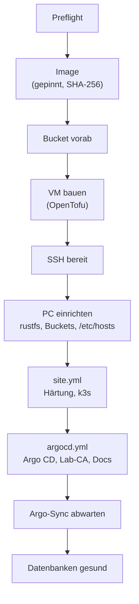

# Lab in 30 Minuten

**Was du bekommst:** ein laufendes k3s-Lab auf deinem Rechner, bestanden durch die
Abnahme, mit geöffneten Oberflächen von Argo CD, Gitea, der Doku und `whoami`.
**Zeit:** gemessen etwa 24 Minuten Aufbau von Grund auf plus etwa 5 Minuten
Abnahme (siehe [Messwerte](#messwerte)).

!!! info "Voraussetzung: das Repo ist schon eingerichtet"
    Dieses Tutorial ist der **zweite Durchgang**. Es setzt voraus, dass dein
    Repo bereits `lab.local.yaml`, deine Schlüssel (`lab.sh init`) und den
    eingetragenen Deploy-Key hat. Das einmalige Einrichten steht in
    [Lab für Freunde](lab-for-friends.md). Der Betreiber des Labs hat das schon.

## 1. Vor dem Start prüfen (1 Minute)

```bash
cd ~/projects/k8s-lab
bash scripts/lab.sh preflight
```

`preflight` prüft Werkzeuge, libvirt, Plattenplatz, Schlüssel, Git-Stand
(`repo_url`, `known_hosts`, Deploy-Key) und die Netzwerte. Er legt nichts an. Jede
Zeile beginnt mit `ok`, `Warnung` oder `FEHLER`; bei `FEHLER` zuerst
[Fehlersuche](../how-to/troubleshooting.md) lesen.

## 2. Aufbauen (etwa 24 Minuten)

```bash
bash scripts/lab.sh up
```



`up` gibt jede Phase mit Zeit aus und am Ende, wie viele Änderungen jeder
Ansible-Lauf gemacht hat. Die meiste Zeit (gemessen etwa 19 Minuten) frisst der
Argo-Sync: Charts holen, Datenbanken starten, Zertifikate ausstellen. Läuft die
VM schon, ist `up` in etwa 1,5 Minuten durch und meldet `changed=0` (ausser
`site.yml` mit 2).

Bricht `up` bei einem alten WAL-Archiv im Bucket mit `Expected empty archive` ab,
war das eine frühere Lab-Instanz. Zum Neubeginn `rebuild`
([Neuaufbau](../how-to/rebuild.md)), das leert das Archiv. Zum Wiederherstellen
`rebuild --restore` ([Datenbank wiederherstellen](../how-to/restore-database.md)).
Git bleibt dabei auf `initdb`.

## 3. Abnehmen (etwa 5 Minuten)

```bash
bash scripts/lab.sh acceptance
```

Die Abnahme prüft alles der Reihe nach, fragt `sudo` für den Backup-Test und
beweist die Wiederherstellung mit Dummy-Daten. Am Ende steht
`ACCEPTANCE PASSED` oder `ACCEPTANCE NOT PASSED` mit der roten Phase. Details:
[Abnahme](../how-to/acceptance.md), [Prüfungen](../reference/acceptance-checks.md).

## 4. Der Lab-CA vertrauen und umschauen

Der Browser meldet bis hierhin „nicht vertrauenswürdig“, weil das Lab eine eigene
CA hat. [Lab-CA vertrauen](../how-to/trust-lab-ca.md), dann:

| Was | Adresse | Zugang |
|---|---|---|
| Argo CD | `https://argocd.lab.example:8444` | `admin`, Initial-Passwort aus [Argo CD bedienen](../how-to/argocd-access.md) |
| whoami | `https://whoami.lab.example:8444` | offen im Admin-Netz |
| Doku (diese Seite) | `https://docs.lab.example` | offen im Ingress-Netz |
| Gitea | `https://git.lab.example` | Admin-Passwort aus der Geheimnis-Karte |

Die `/etc/hosts`-Einträge hat `up` selbst gesetzt.

Zum Schauen (nie zum Ändern; Änderungen laufen über Git):

```bash
export KUBECONFIG=~/.kube/k3s-lab.kubeconfig
kubectl get nodes
kubectl -n argocd get applications     # all Synced / Healthy
kubectl get certificate -A             # all READY True
# `kubectl get backup` shows K8up objects; for CNPG use the full name
kubectl -n db-lab get backups.postgresql.cnpg.io
```

## 5. Aufräumen

```bash
bash scripts/lab.sh down      # removes the VM; backups, keys and rustfs stay
```

`down` verlangt vorher einen frischen Export der VM (Schutz) und fragt nach. Alle
Stufen des Abbaus erklärt [Neuaufbau](../how-to/rebuild.md#was-bleibt-was-geht).

## Messwerte {#messwerte}

| Lauf | Dauer | Stand |
|---|---|---|
| `lab.sh rebuild --restore`, VM 8 GiB | 22 min 12 s, Exit 0, Spitze 5332 MiB / 67 % | 07.11.2026, Ende 23:29:06 Europe/Zurich, Stand `1dd0b72`; Import-Abnahme SKIP, nicht PASS |
| `lab.sh rebuild --restore`, VM rund 10 GiB | 27 min 14 s, Exit 0, 26 Ablaufphasen OK | 07.11.2026, Ende 17:12:56 Europe/Zurich; Import-Abnahme SKIP, nicht PASS |
| `lab.sh rebuild` (`down` plus `up`) | 23 min 36 s (Argo-Sync 18 min 59 s) | 2026-10-30 15:50, Zeitzone Europe/Zurich (älterer Stand) |
| `lab.sh up` auf laufender VM | 1 min 29 s (`site.yml` changed=2, Rest 0) | gleiche Messung |
| `lab.sh acceptance` | 4 min 23 s, 11 von 11 Phasen | gleiche Messung (heute hat die Abnahme neunzehn Phasen) |

Beim Lauf auf 8 GiB lag die Node-Spitze bei 5332 MiB / 67 % (23:28), danach rund 4700 MiB; beim früheren Lauf
auf rund 10 GiB bei 4970 MiB / 49 % (17:12:44), jeweils am 07.11.2026 Europe/Zurich. Fehlende
Import-Baselines bedeuten keine bestandene Import-Abnahme; Details und Grenzen
stehen unter [Neuaufbau](../how-to/rebuild.md). Die ältere `acceptance`-Messung
wird durch den Restore nicht ersetzt.

Die Messung stammt vom Rechner des Autors; dein Rechner und deine Leitung
verschieben die Zeiten, besonders den Argo-Sync.

## Wie weiter

- Verstehen, was du gebaut hast: [Architektur](../concepts/architecture.md).
- Jeden Schritt nachlesen und selbst nachbauen: [Lernpfad](../learning-path/index.md).
- Etwas kaputt machen und reparieren: [Failover-Übung](../how-to/failover-drill.md),
  [Datenbank wiederherstellen](../how-to/restore-database.md).
