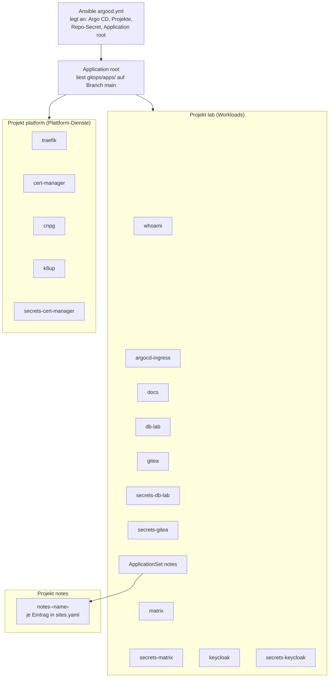

# Referenz: gitops/ (Aufbau und Regeln)

Was hier liegt, setzt Argo CD im k3s-Lab um. Ansible hat Argo CD nur
gestartet (`ansible/argocd.yml`); ab dann ist dieser Ordner die Steuerung.

**Regel: Änderungen über Git, `kubectl` nur zum Schauen.** Von Hand geänderte
Objekte setzt Argo CD (Self-Heal) auf den Git-Stand zurück.

Diese Datei ist zugleich die Dokumentationsseite „Referenz: gitops/“. Darum
stehen Verweise auf andere Seiten als Pfade in Code-Schrift und nicht als Links.

## App-of-Apps



- `root` (von Ansible angelegt) liest `gitops/apps/` auf Branch `main`.
- Jede Datei in `apps/` ist eine Application im Namespace `argocd` mit
  automatischem Sync, Prune und Self-Heal.
- **Es gibt keine Sync-Waves zwischen den Apps.** Apps, die eine CRD einer anderen
  App brauchen (zum Beispiel `IngressRoute` aus `traefik`, `Certificate` aus
  `cert-manager`), versuchen den Sync bei Fehlschlag erneut (`retry`, bis 5 Mal,
  Pause 10 s, Faktor 2, höchstens 3 Minuten). Begründung:
  `docs/concepts/decisions/0003-retries-instead-of-sync-waves.md`.

## Aufbau

```text
gitops/
  apps/              <- die Root-App "root" schaut hierhin
    whoami.yaml      <- Application (Projekt lab): zeigt auf workloads/whoami
    argocd-ingress.yaml <- Application (Projekt lab): zeigt auf workloads/argocd
    docs.yaml        <- Application (Projekt lab): zeigt auf workloads/docs
    notes.yaml       <- ApplicationSet (Projekt lab): pro Eintrag in sites.yaml
                        eine Application notes-<name> (Projekt notes)
    traefik.yaml     <- Application (Projekt platform): Helm-Chart + platform/traefik
    cert-manager.yaml <- Application (Projekt platform): OCI-Chart + platform/cert-manager
    secrets-cert-manager.yaml <- Application (Projekt platform): secrets/cert-manager
                        (KSOPS entschlüsselt)
    cnpg.yaml        <- Application (Projekt platform): 2 Helm-Charts (CNPG-Operator,
                        Barman-Cloud-Plugin) + platform/cnpg
    db-lab.yaml      <- Application (Projekt lab): zeigt auf workloads/db-lab
    secrets-db-lab.yaml <- Application (Projekt lab): secrets/db-lab (S3-Zugang)
    k8up.yaml        <- Application (Projekt platform): Helm-Chart k8up + platform/k8up
    gitea.yaml       <- Application (Projekt lab): Helm-Chart gitea + workloads/gitea/manifests
    secrets-gitea.yaml <- Application (Projekt lab): secrets/gitea (DB, Admin, S3, restic)
    matrix.yaml      <- Application (Projekt lab): Chart charts/matrix + workloads/matrix/manifests
    secrets-matrix.yaml <- Application (Projekt lab): secrets/matrix (DB, Admin, Signatur, S3, restic)
    keycloak.yaml    <- Application (Projekt lab): Chart charts/keycloak + workloads/keycloak/manifests
    secrets-keycloak.yaml <- Application (Projekt lab): secrets/keycloak (DB, Admin, OIDC-Clients, S3)
  platform/
    traefik/
      values.yaml    <- Werte für das Traefik-Chart
      manifests/     <- eigene Traefik-Objekte (TLSOption, TLSStore, Middleware, NetworkPolicy)
    cert-manager/
      values.yaml    <- Werte für das cert-manager-Chart
      manifests/     <- ClusterIssuer lab-ca, Traefik-Default-Zertifikat, NetworkPolicy
    cnpg/
      values-operator.yaml <- Werte für das Chart cloudnative-pg
      values-plugin.yaml   <- Werte für das Chart plugin-barman-cloud
      manifests/     <- NetworkPolicy für cnpg-system
    k8up/
      values.yaml    <- Werte für das Chart k8up
      manifests/     <- NetworkPolicy für k8up
  workloads/
    whoami/          <- Namespace, Deployment, Service, IngressRoute, Certificate
    argocd/          <- Argo-CD-UI: IngressRoute, Certificate, NetworkPolicy
                        (Argo CD selbst installiert Ansible)
    docs/            <- Doku-Site: Deployment (builder + web), Service,
                        IngressRoute, Certificate, NetworkPolicy
                        (Namespace und Repo-Secret legt Ansible an)
    db-lab/          <- Übungs-Datenbank: Namespace, Cluster pg-lab, Pooler,
                        ObjectStore (S3), ScheduledBackup, NetworkPolicy
                        (Runbook: docs/learning-path/stage-8b-cnpg.md)
    gitea/
      values-gitea.yaml <- Werte für das Chart gitea (ausserhalb von manifests/,
                        sonst rendert Argo CD sie als Manifest)
      manifests/     <- Namespace, Cluster gitea-db, Pooler, ObjectStore,
                        ScheduledBackup, K8up-Schedule, Zertifikat,
                        IngressRoute, NetworkPolicy
                        (Runbook: docs/learning-path/stage-8c-gitea.md)
    matrix/
      manifests/     <- Namespace, Synapse, Element, Cluster matrix-db, Pooler,
                        ObjectStore, ScheduledBackup, K8up-Schedule, Zertifikat,
                        IngressRoute, NetworkPolicy, LimitRange, PVC
                        (Runbook: docs/how-to/matrix.md)
    keycloak/
      manifests/     <- Namespace, Keycloak, Cluster keycloak-db, ObjectStore,
                        ScheduledBackup, Zertifikat, IngressRoute (nur /realms/lab/),
                        NetworkPolicy, LimitRange, Job keycloak-config (Realm als Code)
                        (Runbook: docs/how-to/keycloak.md)
  charts/
    notes-site/      <- Helm-Chart einer Notiz-Site (builder + web, Basic-Auth)
    matrix/          <- Konfiguration von Synapse und Element (serverName aus lab.yaml)
    keycloak/        <- Realm lab als ConfigMap (Clients gitea und synapse, Gruppen)
  sites.yaml         <- Liste der Notizbücher (liest auch Ansible)
```

## Projekte (Vertrauensanker)

Zwei Projekte legt Ansible an
(`ansible/inventory/group_vars/all/argocd.yml`), sie kommen nicht aus diesem
Ordner:

| Projekt | Zweck | Namespaces | Zusätzlich erlaubt |
|---|---|---|---|
| `lab` | Workloads | `argocd`, `whoami`, `docs`, `db-lab`, `gitea`, `matrix`, `keycloak` (Liste `argocd_project_namespaces`) | Chart-Quellen aus `argocd_project_chart_repos`; cluster-weit nur `Namespace` |
| `platform` | Plattform-Dienste | `traefik`, `cert-manager`, `cnpg-system`, `k8up` | zusätzliche Chart-Quellen, CRDs, ClusterRole und ClusterRoleBinding, IngressClass, Webhook-Konfigurationen, ClusterIssuer |

Ein drittes Projekt `notes` gehört den Notiz-Sites (Namespaces `notes-<name>`);
Ansible legt es zusammen mit den Namespaces und Secrets an (Rolle `notes_sites`).
Die offene Härtung dieser Grenze (Projekt `default` leer, eigenes Projekt für
`root`, signierte Commits) steht in [Issue 6](https://github.com/tabee/k8s-lab-template/issues/6).

Weitere Zuständigkeiten:

- Namespace `cert-manager` legt Ansible an (Rolle `lab_ca`). Das CA-Secret
  kommt verschlüsselt aus `secrets/cert-manager/` (Application
  `secrets-cert-manager`, siehe unten). Zertifikate:
  `docs/concepts/certificates.md`.
- Namespace `docs` und das Repo-Secret der Doku-Site ebenso (Rolle
  `docs_site`). Doku-Site: `docs/how-to/docs-site.md`.
- Notiz-Sites: `sites.yaml` ist die einzige Liste. Namespaces `notes-<name>`,
  Secrets und das Projekt `notes` legt Ansible an (Rolle `notes_sites`),
  den Rest das ApplicationSet. Runbook: `docs/how-to/notes-sites.md`.
- Die Workloads laufen in eigenen Namespaces mit PSA `restricted`.
- Von aussen: Traefik auf 80/443 (80 leitet auf 443 um). Details:
  `docs/concepts/network-edge.md`.

## Secrets (KSOPS)

Verschlüsselte Secrets liegen **nicht** hier, sondern im Repo-Root unter
`secrets/<namespace>/` (`*.sops.yaml` plus `kustomization.yaml` und
`ksops.yaml`). Je Ordner zeigt eine Application `apps/secrets-<namespace>.yaml`
darauf; der repo-server entschlüsselt beim Rendern mit KSOPS.

- Werte sind verschlüsselt, Name, Namespace und Labels lesbar.
- Jedes Secret trägt `argocd.argoproj.io/sync-options: Prune=false,Delete=false`:
  Argo CD legt an und aktualisiert, löscht aber nie.
- Die öffentliche Kopie des Repos lässt `secrets/` und `gitops/apps/secrets-*.yaml`
  nicht einfach weg: der Export (`docs/how-to/public-release.md`) ersetzt sie
  durch Beispiele und prüft das Ergebnis mit dem Wächter.
- Ablauf (anlegen, ändern, Schlüssel wechseln, Notfall): `docs/how-to/secrets.md`
  und `docs/concepts/secret-flow.md`; Prüfung `ansible/verify-ksops.yml`.

## Neue App hinzufügen

1. Manifeste nach `workloads/<name>/` (eigener Namespace mit PSA-Labels,
   Security-Context wie bei whoami).
2. `apps/<name>.yaml` nach dem Muster von `apps/whoami.yaml`.
   `repoURL`, `targetRevision` und `project` müssen zu
   `ansible/inventory/group_vars/all/argocd.yml` passen.
   Den neuen Namespace dort in `argocd_project_namespaces` eintragen und
   `ansible-playbook argocd.yml` laufen lassen (Projekte sind Vertrauensanker,
   sie kommen nicht aus diesem Ordner).
3. Committen und pushen. Argo CD holt den Stand innerhalb von etwa 3 Minuten.

Ausführlich: `docs/how-to/add-app.md`.

App entfernen: Datei aus `apps/` löschen und pushen. Prune entfernt die
Application, der Finalizer räumt ihre Ressourcen weg.
